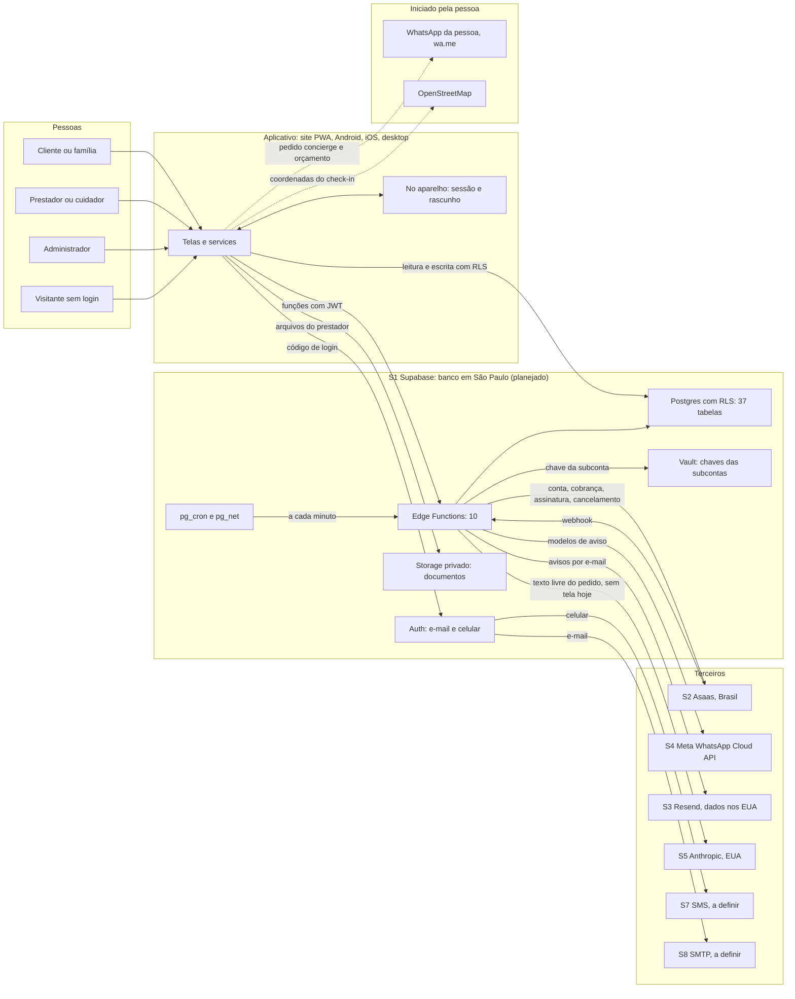

# Registro das Operações de Tratamento de Dados Pessoais (ROPA) do WorkEasy

> **Rascunho para revisão de advogado. Não é parecer jurídico.**

| | |
|---|---|
| Controlador | [RAZÃO SOCIAL], CNPJ [CNPJ], [ENDEREÇO] |
| Canal dos titulares | [E-MAIL DO SAC] |
| Encarregado | [E-MAIL DO ENCARREGADO] |
| Versão | 2026-10-rascunho (a mesma etiqueta de `apps/web/config/legal.ts`) |
| Data de vigência | [DATA DE VIGÊNCIA] |
| Conferido contra o código em | 23/10/2026, ramo `claude/plano-restante`, commit `961af70` |
| Fontes externas abertas em | 23/10/2026 (lista na seção 15) |
| Estado do produto | Protótipo no `main` do repositório remoto (commit `961af70`). Não implantado, sem usuários e sem dados reais. |
| Arquivo irmão | `07-registro-das-operacoes-de-tratamento.csv`: as mesmas operações, uma linha cada |

## Como ler

1. Cada linha das tabelas A, B e C é uma operação de tratamento (OP-01 a OP-25). O número liga as três tabelas e a linha do CSV.
2. A tabela A diz o que se faz e por quê. A tabela B diz por onde os dados passam. A tabela C diz por quanto tempo ficam, quem acessa, como são protegidos e onde isso está no código.
3. **Negrito** em dados quer dizer “pode ser sensível” (art. 5, II, da LGPD). No CSV, a mesma marca é `[SENSÍVEL?]`.
4. `[PLANEJADO]` é o que ainda não existe. `[CONDICIONAL: depende de parecer]` é o que depende de opinião de advogado. `[incerto]` é o que não consegui conferir; o número `(I1)` remete à lista da seção 14.2.
5. “Conferido” quer dizer que li o texto na página oficial em 23/10/2026. “A confirmar” quer dizer que ainda não há contrato, conta ou fonte aberta. As datas estão em dd/mm/aaaa; a etiqueta de versão `2026-10-rascunho` é a exceção.
6. Fornecedores têm código S1 a S8 (seção 7). As perguntas ao advogado são Q1 a Q34 (seção 14.1).
7. “CRM” aqui é a lista de clientes do prestador. Não é o conselho de medicina.
8. “Anonimizado” é a palavra que o produto usa. Se ela é correta, é a pergunta Q19.
9. Caminhos de arquivo: `M01` a `M13` são as migrations (tabela na seção 2.7); `fn/` é `supabase/functions/`; `sh/` é `supabase/functions/_shared/`; `T/` é `supabase/tests/database/`; os demais caminhos são relativos a `apps/web/`.

**Por onde começar**

| Quem lê | Comece por |
|---|---|
| Advogado | O resumo acima; depois a seção 14 (perguntas Q1 a Q34 e itens `[incerto]`), a seção 8 (transferência internacional) e as tabelas A e B |
| Dono do projeto | O resumo; a seção 10 (o que a exclusão da conta deixa) e a tabela C (prazos, acessos e medidas) |
| Revisor de loja (Google Play, App Store) | As tabelas A e B, as seções 9.4 e 9.5 e a seção 12 |

## Resumo para quem tem pouco tempo

1. São 25 operações. O banco tem 37 tabelas, todas com RLS; 32 guardam dado pessoal e 5 são catálogo ou configuração. Das 10 Edge Functions, 9 mandam dados a terceiros (Asaas, Meta, Resend, Anthropic).
2. Nada disso está em uso. Sem empresa, sem contas nos fornecedores, sem usuários. As colunas de região e de contrato descrevem o plano e o que li nas páginas oficiais.
3. Nos contratos de tratamento de dados de Supabase, Resend, Anthropic e Cloudflare, uma busca no texto inteiro não achou Brasil, LGPD nem ANPD; eles usam cláusulas da União Europeia. O Supabase prevê adaptá-las a outras jurisdições e assinar depois um aditivo com o mecanismo que a autoridade local aprovar; o Resend aceita assinar cláusulas-padrão em acordo separado, a pedido. A ANPD exige adoção integral das cláusulas dela. A exceção é a Twilio, uma das opções para o SMS do login: o DPA dela já incorpora as cláusulas da ANPD. Se esses caminhos bastam, e qual mecanismo da LGPD vale para cada fornecedor, é decisão do advogado (seção 8).
4. Supabase em São Paulo é só intenção: nenhum projeto existe, e as Edge Functions rodam, por padrão, na região mais próxima de quem chama. O código não fixa a região (I19).
5. Pode haver dado sensível em: foto de documento com selfie, textos livres (pedido, proposta, notas, relatório do plantão) e toda a linha Cuidado, que envolve idosos e, às vezes, crianças. O produto diz que não guarda dado de saúde, mas só uma trava de palavras no cliente sustenta isso.
6. A exclusão de conta deixa para trás: o `audit_log` (imutável, com motivos digitados), os eventos do Asaas, o cliente e a subconta no Asaas, a chave da subconta no Vault, e logs e cópias de segurança dos fornecedores (seção 10). Também não existe prazo de descarte para itens encerrados.
7. O assistente de IA (OP-22) está pronto no servidor, mas nenhuma tela o chama.

## 1. Quem registra e por quê

1.1. O art. 37 da LGPD diz: “O controlador e o operador devem manter registro das operações de tratamento de dados pessoais que realizarem, especialmente quando baseado no legítimo interesse.”

1.2. Controlador: [RAZÃO SOCIAL], CNPJ [CNPJ], [ENDEREÇO]. É a empresa de tecnologia que o dono do projeto vai criar, separada de qualquer clínica ou atividade médica dele. Ela ainda não existe; até lá, os dados da empresa são marcadores.

1.3. Canal dos titulares: [E-MAIL DO SAC]. Encarregado: [E-MAIL DO ENCARREGADO]. Quem será o encarregado e se a empresa fica dispensada da indicação são perguntas do advogado (Q2).

1.4. Gestor responsável por este registro: a empresa designa [PLANEJADO]. Até lá, o dono do projeto.

1.5. Principal atividade: marketplace e ferramenta de gestão para prestadores de serviço e profissionais liberais, em 44 áreas e 1.710 ocupações, por site (PWA), Android, iOS e desktop, com banco, arquivos e funções no Supabase.

1.6. O WorkEasy não tem integração com sistemas de clínica ou de prontuário. Que a separação entre as empresas seja também uma regra interna, com acessos separados, é um passo [PLANEJADO].

1.7. Este registro segue os oito blocos do modelo da ANPD para agentes de pequeno porte (seção 12), mas na versão completa: traz base legal por operação, operadores, regiões e transferência internacional.

1.8. Documentos relacionados, na pasta `docs/juridico/`. Foram escritos em paralelo a este e seguem em rascunho. Antes de publicar qualquer um, conferir se os números, as bases e os prazos batem com este registro (Q34).

| Documento | Arquivo | Como usar este registro |
|---|---|---|
| 03, Política de Privacidade | `03-politica-de-privacidade.md` | Fonte dos dados, das finalidades, dos fornecedores, da transferência internacional e dos prazos que a Política descreve aos titulares |
| 06, RIPD | `06-ripd-relatorio-de-impacto.md` | Ponto de partida para as operações de maior risco: OP-06 e OP-18 a OP-22 |
| 08, Plano de resposta a incidentes | `08-plano-de-resposta-a-incidentes.md` | Lista de fornecedores (seção 7) e o prazo de aviso de incidente de cada um |
| 09, Segurança da informação | `09-politica-de-seguranca-da-informacao.md` | Medidas da tabela C e acessos da equipe (OP-24 e OP-25) |
| 10, SAC | `10-sac-e-atendimento.md` | Canal dos titulares e prazos de resposta (Q26) |
| 11, Textos de consentimento e avisos | `11-textos-de-consentimento-e-avisos.md` | Operações que dependem de aviso ou de consentimento: OP-02, OP-06, OP-18 e OP-20 |

## 2. O que este registro cobre

2.1. Cobre `apps/web`, o aplicativo, e `apps/web/supabase`, o banco, os arquivos e as funções.

2.2. Fica de fora o que o README da raiz do repositório descreve como outros sistemas: `services/api`, `apps/mobile` e `apps/web-prefeitura`. Não os analisei. Se algum for usado com dados reais, precisa de linhas próprias (Q3).

2.3. Hoje não existe tratamento real. O produto não foi implantado, não tem usuários e nada foi testado contra o Asaas, o WhatsApp ou o Resend reais. O registro descreve o desenho que vale a partir do primeiro dado real e deve ser revisado antes da implantação.

2.4. Comissão e pagamento retido (escrow) estão desligados: `platform_settings.commission_enabled` e `escrow_enabled` valem `false`. Qualquer tratamento que dependa deles [CONDICIONAL: depende de parecer] não consta como ativo.

2.5. O banco tem 37 tabelas em `public`. Todas têm RLS ligada (conferido por contagem nas migrations). 32 guardam dado pessoal. As outras 5 são catálogo e configuração: `areas`, `occupations`, `occupation_policies`, `neighborhoods` e `platform_settings`.

2.6. A seção 9 lista as 37 tabelas, os outros armazenamentos, as 10 funções e os fluxos que a pessoa inicia fora do servidor.

2.7. Siglas das migrations, na pasta `supabase/migrations/`:

| Sigla | Arquivo |
|---|---|
| `M01` | `20261019000001_identity.sql` |
| `M02` | `20261019000002_catalog.sql` |
| `M03` | `20261019000003_providers.sql` |
| `M04` | `20261019000004_marketplace.sql` |
| `M05` | `20261019000005_bookings.sql` |
| `M06` | `20261019000006_payments.sql` |
| `M07` | `20261019000007_quotes_reviews.sql` |
| `M08` | `20261019000008_notifications.sql` |
| `M09` | `20261019000009_care.sql` |
| `M10` | `20261019000010_privacy_audit.sql` |
| `M11` | `20261019000011_admin.sql` |
| `M12` | `20261022000012_monetization.sql` |
| `M13` | `20261022000013_service_role_trigger_helpers.sql` |

## 3. Papéis propostos

3.1. Os papéis abaixo são uma proposta de partida. O art. 5, VI e VII, define controlador e operador, e o art. 39 diz que o operador trata “segundo as instruções fornecidas pelo controlador”. Quem ocupa cada papel em cada fluxo é pergunta do advogado (Q1).

| Situação | Papel do WorkEasy | Outro agente |
|---|---|---|
| Conta, pedidos, atendimentos, pagamentos, avaliações, avisos, auditoria e administração | Controlador | Operadores S1 a S8 (seção 7) |
| CRM do prestador, orçamentos e cobrança de clientes próprios | Operador da ferramenta do prestador [CONDICIONAL: depende de parecer] | O prestador decide a finalidade e é controlador da relação com o cliente dele |
| Nome e telefone que o cliente e o prestador passam a ver um do outro | Controlador, para executar o contrato | Cliente e prestador |
| Cobrança, conta de recebimento e assinatura | Controlador dos dados que envia | Asaas: operador sobre o que o contratante insere e controlador para obrigações regulatórias dele |
| Aviso por WhatsApp | Controlador dos dados que envia | Meta: operador no envio; controlador independente nos demais casos |

## 4. Tabela A: o que se faz e por quê

As bases legais abaixo são propostas a validar. “Art. 7” e “art. 11” são os da LGPD.

| ID | Operação | Titulares | Dados pessoais | Finalidade | Base legal proposta | Estado e perguntas |
|---|---|---|---|---|---|---|
| **OP-01** | Conta, login por código e perfil | Qualquer pessoa que cria conta: cliente, família, prestador, cuidador, administrador | E-mail ou celular (E.164) que recebe o código; nome (opcional); telefone do perfil (digitado, não confirmado); cidade (padrão São Paulo); papel (cliente ou prestador); datas de criação e de exclusão.<br>No Auth do Supabase também ficam tabelas internas de sessão e token, que não foram analisadas [incerto] (I1).<br>*Sensível?* não | Criar e autenticar a conta; identificar a pessoa nos atendimentos; permitir contato entre as partes. | Art. 7, V (execução de contrato ou procedimentos preliminares a pedido do titular). | Implementado; testado só contra o banco local.<br>*Perguntas:* Q2, Q16, Q31 |
| **OP-02** | Consentimentos e aceite dos textos | Usuários com conta | Finalidade (terms, privacy, marketing, background_check, location), versão do texto, aceito ou recusado, data e hora do servidor, id do usuário.<br>*Sensível?* não | Provar aceites e escolhas; liberar o que depende de consentimento (certidão de antecedentes, localização). | Art. 7, II e VI (o controlador deve demonstrar o consentimento: arts. 6, X, e 8, § 2º) [a validar]. | Implementado. Os aceites apontam para a versão 2026-10-rascunho de textos que ainda não estão publicados (a tela /legal diz “em elaboração”).<br>*Perguntas:* Q5, Q21 |
| **OP-03** | Direitos do titular: cópia dos dados e exclusão da conta | Qualquer usuário que peça a cópia ou a exclusão | Todos os dados do titular listados no plano de exportação (26 consultas, incluindo dados sensíveis que existirem); registro do pedido (tipo, situação, datas, caminho do resultado).<br>*Sensível?* possível (exporta o que houver) | Atender os direitos do art. 18 da LGPD: acesso, portabilidade em JSON, eliminação e anonimização. | Art. 7, II (cumprimento de obrigação legal: art. 18). | Implementado, com lacunas conhecidas na cópia dos dados e na exclusão (seção 10; Q20, Q25).<br>*Perguntas:* Q19, Q20, Q25, Q26 |
| **OP-04** | Trilha de auditoria | Usuários e administradores que praticam ou sofrem ações registradas | Id do autor (sem chave estrangeira), ação, entidade, id da entidade, data e hora, e um JSON com dados da ação: situações, valores, ids, e **motivos digitados por usuários e administradores (texto livre)**.<br>booking_events guarda a situação anterior e a nova, o autor e o motivo de cada mudança de um atendimento.<br>*Sensível?* possível (texto livre dos motivos) | Segurança, prestação de contas, prova em disputa e em ação administrativa ou de dinheiro. | Art. 7, IX (legítimo interesse: segurança e prestação de contas, art. 6, X) e VI [a validar]. Exige avaliação de legítimo interesse documentada (art. 37 destaca esse caso) (Q4). | Implementado; sem política de retenção. log_event nunca é chamado por código do cliente hoje.<br>*Perguntas:* Q4, Q20 |
| **OP-05** | Cadastro profissional e página pública do prestador | Prestadores (pessoas físicas ou representantes de empresas) e cuidadores | Nome de exibição; endereço da página (slug); bio; avatar (o campo existe, não há tela de envio); plano e situação; ocupações; número e UF do registro no conselho e sua situação; bairros atendidos e bairro-base; serviços (título, descrição, preço, duração); disponibilidade semanal e folgas; notas e comentários publicados.<br>*Sensível?* não | Dar ao prestador a ferramenta de trabalho; exibir perfil e serviços na busca; receber pedidos por ocupação e bairro. | Art. 7, V (contrato com o prestador que pede a página) [a validar para a exibição pública]. | Implementado.<br>*Perguntas:* Q13 |
| **OP-06** | Documentos de verificação do prestador e análise administrativa | Prestadores e cuidadores | **Foto de documento com foto e selfie** (exigidos em todas as 1.710 ocupações do catálogo); comprovante de CPF ou CNPJ (todas); registro no conselho (778); **certidão de antecedentes criminais** (631); licença ou alvará (254); certificado de curso (122); CNH (59); seguro de responsabilidade civil (1). Arquivos JPG, PNG, WebP, HEIC ou PDF de até 10 MB. Metadados: caminho, situação, revisor, data, motivo da recusa, validade (campo sem uso). Contagens do catálogo em 23/10/2026.<br>*Sensível?* possível (biométrico, art. 5, II) e alto risco (antecedentes) [CONDICIONAL: depende de parecer] | Conferir identidade, habilitação e antecedentes antes de aprovar o prestador; prevenir fraude; proteger clientes e famílias. | Art. 7, V e IX. Certidão de antecedentes: consentimento (art. 7, I), registrado antes do envio (background_check). Documento com foto e selfie, se for sensível: art. 11, II, g (prevenção à fraude e à segurança do titular na identificação e autenticação de cadastro) ou art. 11, I [CONDICIONAL: depende de parecer] (Q6, Q7, Q8). | Implementado.<br>*Perguntas:* Q4, Q6, Q7, Q8, Q22 |
| **OP-07** | Pedidos de serviço do cliente | Clientes; terceiros citados no texto | Ocupação; bairro; descrição livre (10 a 2.000 caracteres) que pode conter **dado de saúde ou de terceiros**; datas preferidas (texto); urgência; situação; validade. Rascunho do formulário em sessionStorage.<br>*Sensível?* possível (texto livre) | Receber propostas de prestadores aprovados na ocupação e no bairro. | Art. 7, V (procedimentos preliminares a pedido do titular). | Implementado.<br>*Perguntas:* Q9, Q10, Q23 |
| **OP-08** | Propostas dos prestadores | Prestadores; clientes | Preço; **mensagem livre** (até 2.000 caracteres); validade; situação; ids do pedido e do prestador.<br>*Sensível?* possível (texto livre) | Negociar e aceitar o serviço; aplicar o limite do plano grátis (5 propostas novas por mês). | Art. 7, V. | Implementado.<br>*Perguntas:* Q9, Q23 |
| **OP-09** | Atendimentos: agendamento, aceite, execução, disputa e trava trabalhista | Clientes; prestadores; terceiros citados nas notas | Ids das partes; ocupação e serviço; período; preço; taxa da plataforma (zero enquanto a comissão estiver desligada); situação; origem (plataforma ou própria); **notas** (até 2.000) e **motivo de cancelamento** (até 1.000); histórico de situações com autor e motivo; id da casa (linha Cuidado).<br>*Sensível?* possível (textos livres) | Executar o serviço contratado; evitar conflito de agenda; limitar dias por semana com o mesmo empregador em ocupações com risco de vínculo doméstico; mediar disputas. | Art. 7, V. Trava trabalhista e disputas: art. 7, IX e VI [a validar] (Q4). | Implementado. Comissão e pagamento retido desligados [CONDICIONAL: depende de parecer].<br>*Perguntas:* Q4, Q9, Q19 |
| **OP-10** | CRM do prestador: clientes próprios e clientes vindos da plataforma | Clientes do prestador, com ou sem conta. Os “próprios” são terceiros que não usam o WorkEasy | Nome; telefone; e-mail; **observações livres** (até 4.000); origem (própria ou plataforma); vínculo com a conta quando vem da plataforma.<br>*Sensível?* possível (observações) | O prestador gerir clientes, orçar e cobrar; reconhecer o mesmo empregador por telefone ou e-mail na trava trabalhista. | Do prestador (controlador do próprio CRM): art. 7, V ou IX. Do WorkEasy: operador da ferramenta [CONDICIONAL: depende de parecer] (Q1, Q13). Na entrada vinda da plataforma, nome e telefone do perfil do cliente são copiados para o CRM do prestador quando o cliente pede agendamento direto ou aceita uma proposta. | Implementado.<br>*Perguntas:* Q1, Q13 |
| **OP-11** | Orçamentos e link público | Clientes do prestador (terceiros, sem conta) | Nome e telefone do cliente; título; itens (descrição, quantidade, preço); validade; **notas**; situação; token público (UUID). Resposta do cliente (aceito ou recusado) sem identificação.<br>*Sensível?* possível (notas) | Enviar proposta formal e receber o aceite do cliente. | Art. 7, V (procedimentos preliminares a pedido do titular) [a validar: quem pediu o orçamento] (Q13). | Implementado.<br>*Perguntas:* Q13, Q27 |
| **OP-12** | Avaliações | Clientes (autores); prestadores (avaliados) | Nota de 1 a 5; **comentário livre** (até 1.000); publicado ou não; ids do atendimento, do autor e do prestador.<br>*Sensível?* possível (comentário) | Informar a reputação do prestador; apoiar a qualidade. | Art. 7, IX (legítimo interesse: confiança entre as partes) ou V [a validar] (Q4). | Implementado.<br>*Perguntas:* Q4 |
| **OP-13** | Conta de recebimento do prestador no Asaas (subconta) | Prestadores (pessoas físicas ou jurídicas) e seus representantes | Enviados ao Asaas: nome, e-mail, CPF ou CNPJ, data de nascimento (pessoa física) ou tipo de empresa, celular, renda ou faturamento mensal, endereço (rua, número, complemento, bairro, CEP) e a configuração do webhook com o e-mail do prestador. Recebidos: id da conta, id da carteira e chave de API da subconta (devolvida uma só vez). Guardados: provider_payment_accounts (ids e situação) e a chave no Vault.<br>*Sensível?* não (dado fiscal e financeiro, de alto impacto) | Abrir a subconta em que o prestador recebe pagamentos e cobra clientes. | Art. 7, V. O Asaas também trata como controlador por obrigação regulatória de instituição de pagamento (cl. 5.8 do Acordo dele). | Implementado; nunca testado contra o Asaas real.<br>*Perguntas:* Q1, Q20, Q28 |
| **OP-14** | Cobrança de atendimento pela plataforma: Pix, cartão e boleto, estorno e conciliação | Clientes que pagam; prestadores que recebem | Enviados ao Asaas: nome, CPF ou CNPJ, e-mail e celular do pagador (cadastrado como cliente do Asaas com a referência user:{uuid}); valor; vencimento; descrição “WorkEasy: atendimento {slug}” (slug da ocupação); referência booking:{uuid}; divisão (split) para a carteira do prestador. Guardados: id do cliente no Asaas; pagamentos (valor, método, situação, link da fatura, QR e código copia-e-cola do Pix, vencimento) e o retorno do gateway (raw) sem campos creditCard*; corpo dos eventos recebidos (payment_events). Cartão: o pagador digita na página do Asaas; o app nunca recebe o número.<br>*Sensível?* não (dado financeiro e fiscal) | Cobrar o atendimento aceito, conciliar pelo webhook, cancelar cobranças abertas e estornar pagamento recebido depois do cancelamento. | Art. 7, V. Guarda do registro: art. 7, II e VI [a validar o prazo] (Q18). Comissão e pagamento retido (escrow) estão desligados [CONDICIONAL: depende de parecer]; com a comissão desligada o split repassa o valor integral à carteira do prestador e a natureza dessa intermediação é questão do parecer (docs/DECISOES.md, seção 4). | Implementado; nunca testado contra o Asaas real. Comissão e retenção desligadas.<br>*Perguntas:* Q1, Q18, Q19, Q20, Q28 |
| **OP-15** | Cobrança de cliente próprio e de orçamento aceito (prestador Pro) | Clientes do prestador (terceiros, em geral sem conta) | Enviados à subconta do prestador no Asaas: nome, CPF ou CNPJ, e-mail e telefone do cliente; valor; vencimento; descrição escrita pelo prestador (até 300 caracteres); referências booking:, quote: e provider_client:{uuid}. Guardados: pagamentos como em OP-14.<br>*Sensível?* não | O prestador cobrar o próprio cliente, sem taxa da plataforma. | Do prestador (controlador da relação com o cliente): art. 7, V. Do WorkEasy: operador da ferramenta [CONDICIONAL: depende de parecer] (Q1, Q13). | Implementado; nunca testado contra o Asaas real.<br>*Perguntas:* Q1, Q13, Q18, Q28 |
| **OP-16** | Assinatura Pro do prestador | Prestadores | Enviados ao Asaas (conta raiz): nome, CPF ou CNPJ, e-mail e celular do prestador; valor da mensalidade (R$ 49,00, configurável); ciclo mensal; primeiro vencimento (fim do teste de 30 dias); referência subscription:{uuid}. Guardados: subscriptions (plano, situação, id no Asaas, fim do período, cancelamento).<br>*Sensível?* não | Cobrar a mensalidade e ligar ou desligar o plano Pro. | Art. 7, V. | Implementado; nunca testado contra o Asaas real.<br>*Perguntas:* Q18, Q28 |
| **OP-17** | Notificações por WhatsApp e e-mail | Clientes, prestadores e cuidadores com contato confirmado no Auth | Telefone ou e-mail confirmado; nome do modelo; parâmetros do texto (nome do prestador, ocupação, data e hora, nome da outra parte, nome de quem pagou, valor, título do orçamento, bairro do plantão); situação, tentativas e erro. Seis modelos, todos operacionais: proposta recebida, atendimento confirmado, lembrete de 24 h antes, pagamento recebido, orçamento respondido, plantão oferecido.<br>*Sensível?* não | Avisos do serviço contratado. O código não gera nenhuma mensagem de marketing, embora exista o consentimento marketing. | Art. 7, V. | Implementado; nunca testado contra WhatsApp nem Resend reais.<br>*Perguntas:* Q14, Q16, Q23, Q28, Q29 |
| **OP-18** | Cuidado: casa e pessoa assistida | Família (dona da conta); pessoa assistida (terceiro, em geral idosa; pode ser criança); contato de emergência (terceiro) | Nome da casa; bairro; **observações livres** (até 2.000); primeiro nome da pessoa assistida; ano de nascimento; **preferências livres** (até 2.000); **contato de emergência** em um campo de texto livre (até 300 caracteres) que a tela orienta a preencher com nome e telefone de quem chamar. Por desenho não há campo de diagnóstico nem de medicação.<br>*Sensível?* possível (texto livre pode revelar saúde) | Organizar os plantões e dar ao cuidador designado o mínimo necessário. | Da família: art. 7, V. Da pessoa assistida (terceiro): art. 7, V ou IX, ou consentimento do responsável; se for criança, art. 14 [CONDICIONAL: depende de parecer] (Q10, Q11). A Res. CD/ANPD 2/2022 trata dados de idosos como critério específico de alto risco (art. 4º, II, d). | Implementado. A linha Cuidado só deve abrir ao público depois dos portões de docs/DECISOES.md (seção 5).<br>*Perguntas:* Q2, Q9, Q10, Q11 |
| **OP-19** | Cuidado: plantões e ofertas a cuidadores | Família; cuidadores (prestadores aprovados com ocupação de cuidado); pessoa assistida (primeiro nome) | Período; valor cobrado da família; repasse ao cuidador; **notas** (até 2.000); situação; ofertas (cuidador e situação); designação.<br>*Sensível?* possível (notas) | Oferecer e designar plantões; aplicar a trava trabalhista, sempre ativa em plantões. | Art. 7, V. Trava trabalhista: art. 7, IX [a validar] (Q4). | Implementado.<br>*Perguntas:* Q4, Q9, Q23 |
| **OP-20** | Cuidado: entrada e saída do plantão com localização | Cuidador; família que consulta o registro | Tipo (entrada ou saída); horário; latitude e longitude do aparelho com 6 casas decimais (cerca de 10 cm), só quando o cuidador consente; consentimento location.<br>*Sensível?* não pela lista do art. 5, II; localização precisa é dado de alto impacto | A família saber onde o registro foi feito e comprovar presença no plantão. | Art. 7, I (consentimento), gravado antes de ler a posição; o registro funciona sem localização (Q12). | Implementado.<br>*Perguntas:* Q12, Q23 |
| **OP-21** | Cuidado: relatório diário do plantão | Cuidador (autor); família (leitora); pessoa assistida (assunto) | **Refeições, atividades, humor e observações** em texto livre, não clínico por desenho; autor; plantão.<br>*Sensível?* possível (humor e refeições podem revelar saúde) | Informar a família sobre o plantão. | Art. 7, V; se o texto revelar saúde: art. 11 [CONDICIONAL: depende de parecer] (Q9). | Implementado.<br>*Perguntas:* Q9, Q23 |
| **OP-22** | Assistente de pedidos com inteligência artificial | Clientes; terceiros citados no texto | Enviados à Anthropic: o texto livre do cliente (10 a 2.000 caracteres), que pode conter **dado de saúde ou de terceiros**, e a lista de até 20 ocupações candidatas. Recebidos: ocupação, urgência e resumo. Guardados no WorkEasy: só um contador por usuário e hora (assist_usage); o texto não é gravado.<br>*Sensível?* possível (a instrução do sistema prevê o caso de emergência de saúde) | Transformar um texto livre em pedido estruturado. | Art. 7, V (a pedido do titular) ou consentimento específico [CONDICIONAL: depende de parecer] (Q9, Q14, Q17). | Função pronta e testada, mas nenhuma tela do app a chama (busca em services, pages, components e lib em 23/10/2026). Sem ANTHROPIC_API_KEY responde 503; ASSIST_HOURLY_LIMIT=0 desliga.<br>*Perguntas:* Q9, Q14, Q17, Q28 |
| **OP-23** | Pedido por WhatsApp (modo concierge) | Quem faz o pedido, sem login; terceiros citados | Serviço; bairro e cidade; quando; urgência; **descrição livre**; nome (opcional). O número de WhatsApp de quem envia fica visível a quem opera o canal.<br>*Sensível?* possível (texto livre) | Atender pedidos com operação manual. O botão do WhatsApp só aparece no app quando ele roda sem Supabase; o plano de 45 dias prevê também receber pedidos que cheguem direto ao número de WhatsApp Business da operação. | Art. 7, V (procedimentos preliminares a pedido do titular). | Implementado no app (o botão só aparece sem backend). O uso do número no piloto está no plano de 45 dias, ainda em rascunho (`docs/operacao/01-plano-de-45-dias-concierge.md`, item P8: aplicativo WhatsApp Business em número dedicado).<br>*Perguntas:* Q14, Q32 |
| **OP-24** | Administração e moderação | Todos os que têm dados no sistema; os próprios administradores | Leitura de perfis (nome e telefone na fila de análise), documentos, registros, pagamentos (lista; raw só por função), disputas, auditoria, métricas, pedidos de dados e configurações. Escrita de decisões com motivo: aprovar ou recusar documentos, registro, situação do prestador, disputas, configurações.<br>*Sensível?* possível (vê todos os dados acima) | Aprovar prestadores, moderar avaliações, resolver disputas, tratar pagamentos que exigem ação, acompanhar pedidos de dados. | Art. 7, V, IX e VI [a validar] (Q4). | Implementado.<br>*Perguntas:* Q4, Q33 |
| **OP-25** | Registros técnicos, armazenamento no aparelho e cópias de segurança | Qualquer visitante ou usuário | (a) Logs de infraestrutura do Supabase (API, Auth, Edge Functions): em geral IP, data e hora, rota e erro; conteúdo e retenção dependem do plano [incerto] (I2). As Edge Functions registram só o nome e a mensagem do erro, nunca corpo de requisição nem segredo. (b) No aparelho: sessão do Supabase em localStorage (persistSession); rascunho do pedido em sessionStorage; cache do PWA só de arquivos estáticos (js, css, html, png, svg). (c) Cópias de segurança do banco: o DPA do Supabase diz que são diárias por padrão e criptografadas (afirmação do fornecedor, não conferida por nós).<br>*Sensível?* não | Operação, depuração, segurança e continuidade; guarda de registros de acesso. | Art. 7, IX (segurança e operação) e II, quanto ao art. 15 do Marco Civil: provedor de aplicações constituído como pessoa jurídica com fins econômicos guarda os registros de acesso por 6 meses [a validar] [incerto] (I12) (Q24). | Parcial: depende da contratação e da configuração do Supabase em produção (pesquisa `docs/pesquisa/supabase-producao.md` [PLANEJADO]).<br>*Perguntas:* Q16, Q24 |

## 5. Tabela B: por onde os dados passam

“Conferido” e “a confirmar” são o estado do contrato de tratamento de dados do fornecedor (seção 7). “São Paulo (planejada)” quer dizer que a região é uma intenção; nenhum projeto existe.

| ID | Origem dos dados | Sistemas e operadores | Região | Contrato de tratamento (DPA) | Transferência internacional e mecanismo |
|---|---|---|---|---|---|
| **OP-01** | O próprio titular (/entrar, /conta); o gatilho handle_new_user copia para o perfil o nome do cadastro e o telefone do Auth. | S1 Supabase (Auth, Postgres: auth.users e public.profiles); S7 provedor de SMS para o código por celular (a definir); S8 servidor SMTP do Auth para o código por e-mail (a definir; bloco comentado no config.toml); aparelho (sessão em localStorage). | S1: São Paulo (sa-east-1), planejada; nenhum projeto criado. S7 e S8: a confirmar. | S1: conferido na página oficial em 23/10/2026 (DPA versão de 01/08/2026); aceite pela empresa a confirmar. S7 e S8: a confirmar. | S1: dados primários na região escolhida, mas suporte e suboperadores nos EUA (lista de 12/10/2026): possível transferência por acesso [incerto] (I10). O DPA prevê cláusulas da UE adaptáveis a outras jurisdições (cl. 12.1(b)); se bastam para a LGPD, ver seção 8 e Q14. S7 e S8: a confirmar. |
| **OP-02** | O titular (TermsGate, /conta, cadastro profissional, registro de plantão). | S1 Supabase (Postgres: consents). | S1: São Paulo (planejada). | S1: conferido (ver OP-01). | Nenhuma além de S1. |
| **OP-03** | O titular, em /conta (botões “Baixar meus dados” e “Excluir minha conta”). | S1 Supabase (Edge Functions account-export e account-delete; Postgres; Storage; Auth); S2 Asaas (cancelamento de assinatura e de cobranças em aberto, só ids). | S1: banco em São Paulo (planejada); a função roda perto de quem chama (I19). S2: sede no Brasil; local dos servidores não informado [incerto] (I3). | S1: conferido. S2: conferido (Acordo de Processamento de Dados Pessoais); aceite pela empresa a confirmar. | Nenhum dado pessoal novo sai: as chamadas ao Asaas levam ids de assinatura e de cobrança. |
| **OP-04** | Gatilhos e funções do banco (private.audit), Edge Functions (log_event com a service role). | S1 Supabase (Postgres: audit_log e booking_events). | S1: São Paulo (planejada). | S1: conferido. | Nenhuma além de S1. |
| **OP-05** | O prestador (/pro/cadastro, /pro/servicos, /pro/agenda); decisões do administrador (situação, aprovação, registro). | S1 Supabase (Postgres; funções search_providers, get_provider_page, slug_available e available_slots abertas ao público); páginas estáticas de SEO usam só o catálogo, sem dados de prestadores. | S1: São Paulo (planejada). | S1: conferido. | Nenhuma além de S1. A página pública pode ser lida por qualquer pessoa, em qualquer país. |
| **OP-06** | O prestador (envio de arquivo); o administrador (revisão). | S1 Supabase (Storage: bucket privado provider-documents; Postgres: provider_documents). Nenhum serviço externo de verificação: não há reconhecimento facial automático; a tela /verification é demonstração e não captura imagem. | S1: São Paulo (planejada). | S1: conferido. | Nenhuma além de S1. |
| **OP-07** | O cliente (/pedido). | S1 Supabase (Postgres: requests; função open_requests_for_me); aparelho (sessionStorage). | S1: São Paulo (planejada). | S1: conferido. | Nenhuma além de S1. O assistente de IA (OP-22) existe no servidor, mas nenhuma tela o chama. |
| **OP-08** | O prestador. | S1 Supabase (Postgres: proposals); aviso ao cliente por OP-17. | S1: São Paulo (planejada). | S1: conferido. | Nenhuma além de S1. |
| **OP-09** | O cliente (agendamento direto, aceite de proposta); o prestador (atendimento próprio e transições); o Asaas (webhook muda para pago, cancelado ou contestado); o administrador (disputas). | S1 Supabase (Postgres: bookings, booking_events; função transition_booking); S2 Asaas (eventos do webhook). | S1: São Paulo (planejada). S2: ver OP-13. | S1: conferido. S2: conferido; aceite a confirmar. | Nenhuma além de S1. |
| **OP-10** | O prestador (clientes próprios); cópia do perfil do cliente (private.ensure_provider_client). | S1 Supabase (Postgres: provider_clients). Lido por OP-15 (envio ao Asaas) e por OP-17 (nome do cliente nos avisos). | S1: São Paulo (planejada). | S1: conferido. | Nenhuma além de S1 (OP-15 trata do envio ao Asaas). |
| **OP-11** | O prestador. | S1 Supabase (Postgres: quotes; funções get_quote_by_token e respond_quote abertas ao anônimo). O prestador pode enviar o link por wa.me pelo WhatsApp dele, fora do servidor, com o nome do cliente, o título e o valor no texto. | S1: São Paulo (planejada). WhatsApp do prestador: fora do controle do WorkEasy. | S1: conferido. WhatsApp pessoal do prestador: não se aplica. | Nenhuma pelo servidor. O envio por WhatsApp é ato do prestador. |
| **OP-12** | O cliente, depois de atendimento da plataforma concluído e pago pelo app. | S1 Supabase (Postgres: reviews; get_provider_page publica as últimas 50 avaliações publicadas). | S1: São Paulo (planejada). | S1: conferido. | Nenhuma além de S1. |
| **OP-13** | O prestador (formulário em /pro/assinatura). | S1 Supabase (Edge Function asaas-onboard; Vault; Postgres); S2 Asaas (POST /accounts). | S1: banco em São Paulo (planejada); a função roda perto de quem chama (I19). S2: a política dele é assinada em Joinville (SC) e admite nuvem em outros países, sem dizer quais [incerto] (I3). | S2: conferido (Acordo de Processamento de Dados Pessoais, anexo à Política de Privacidade de 09/10/2026); começa “a partir da data de sua assinatura” (cl. 13.1): forma de aceite pela empresa a confirmar [incerto] (I14). | Fluxo doméstico se a função rodar em São Paulo (I19). Transferência posterior pelo Asaas, se houver, é dele (cl. 6.1 do Acordo). |
| **OP-14** | O cliente (CPF ou CNPJ no primeiro pagamento, nome do perfil); o Asaas (eventos e consultas de cobrança). | S1 Supabase (Edge Functions payments-create, payments-void e asaas-webhook; Postgres); S2 Asaas (clientes, cobranças, QR Pix, estorno). | S1: banco em São Paulo (planejada); a função roda perto de quem chama (I19). S2: ver OP-13. | S1: conferido. S2: conferido; aceite pela empresa e papel na subconta a confirmar [incerto] (I14). | Doméstico se a função rodar em São Paulo (I19); transferência posterior pelo Asaas é dele (cl. 6.1 do Acordo). Conteúdo exato de raw e do payload do webhook: não conferido [incerto] (I4). |
| **OP-15** | O prestador, que digita os dados do cliente ou os tira do CRM (OP-10) e do orçamento (OP-11). | S1 Supabase (Edge Function charges-create; Vault para a chave da subconta; Postgres); S2 Asaas (subconta do prestador). | S1: banco em São Paulo (planejada); a função roda perto de quem chama (I19). S2: ver OP-13. | S1: conferido. S2: conferido; quem contrata na subconta a confirmar [incerto] (I14). | Como em OP-14. |
| **OP-16** | O prestador (/pro/assinatura); o Asaas (eventos). | S1 Supabase (Edge Functions subscriptions-manage e asaas-webhook; Postgres); S2 Asaas. | S1: banco em São Paulo (planejada); a função roda perto de quem chama (I19). S2: ver OP-13. | S1: conferido. S2: conferido; aceite a confirmar. | Como em OP-14. |
| **OP-17** | Gatilhos do banco; contato confirmado do Auth; nomes consultados por notification-context. | S1 Supabase (Postgres: notifications; pg_cron e pg_net; Edge Function notify-dispatch); S4 Meta (WhatsApp Cloud API, modelos aprovados, Graph API v26.0); S3 Resend (e-mail). | S1: banco em São Paulo (planejada); a função roda perto de quem chama (I19). S4: local do processamento não informado nas páginas abertas [incerto] (I5). S3: dados da conta, metadados e logs nos EUA; o envio pode sair de São Paulo. | S3: conferido (DPA atualizado em 31/12/2025). S4: conferido (Termos da Plataforma de 23/09/2026 e Termos Globais de Operador de 20/03/2026, lidos por leitor de página); qual instrumento vale para a Cloud API: a confirmar [incerto] (I15). Aceite pela empresa: a confirmar. | S3: sim, EUA; o DPA usa cláusulas da UE e não cita a LGPD; mecanismo da LGPD a definir [incerto] (I10). S4: contratante é a Meta Platforms Ireland Limited; o Global Data Transfer Addendum se aplica a certas transferências; a ANPD reconheceu a UE como adequada (Res. 32/2026, segundo a página dela), mas o local da infraestrutura não foi confirmado. |
| **OP-18** | A família. | S1 Supabase (Postgres: households e care_recipients). | S1: São Paulo (planejada). | S1: conferido. | Nenhuma além de S1. |
| **OP-19** | A família; o cuidador (aceite, cancelamento). | S1 Supabase (Postgres: shifts e shift_offers); aviso plantao_oferecido por OP-17. | S1: São Paulo (planejada). | S1: conferido. | Nenhuma além de S1. |
| **OP-20** | O aparelho do cuidador (API de localização do navegador ou do sistema). | Aparelho (permissões declaradas no Android e no iOS); S1 Supabase (Postgres: checkins). A família abre o ponto no OpenStreetMap por um link que leva as coordenadas na URL: é ato da pessoa que clica e envia as coordenadas a um site de terceiro. | S1: São Paulo (planejada). OpenStreetMap: terceiro, fora do controle do WorkEasy. | S1: conferido. OpenStreetMap: não é operador; não há DPA. | Nenhuma pelo servidor. O clique da família leva as coordenadas do cuidador a um site de terceiro; se isso é transferência, coleta ou divulgação, a definir com o advogado [incerto] (I10). |
| **OP-21** | O cuidador designado. | S1 Supabase (Postgres: daily_reports). | S1: São Paulo (planejada). | S1: conferido. | Nenhuma além de S1. |
| **OP-22** | O cliente. | S1 Supabase (Edge Function request-assist; Postgres: assist_usage); S5 Anthropic (API de mensagens, modelo claude-haiku-5-5). | S1: banco em São Paulo (planejada); a função roda perto de quem chama (I19). S5: Estados Unidos; o único local de dados em repouso oferecido é “us” e a inferência é “global” por padrão; o código não define inference_geo. | S5: conferido (DPA em vigor desde 24/02/2025 e Termos Comerciais de 17/06/2025); o DPA descreve categorias especiais de dados como “None”; lista de suboperadores não aberta [incerto] (I6). Aceite pela empresa: a confirmar. | Sim, para os EUA. O DPA usa cláusulas da UE na medida em que as leis aplicáveis exigirem e não cita a LGPD; mecanismo da LGPD a definir [incerto] (I10). Os Termos Comerciais dizem que a Anthropic não pode treinar modelos com o conteúdo dos clientes enviado aos Serviços. |
| **OP-23** | O próprio titular, por mensagem. | O app só monta o texto e abre wa.me; nada é enviado até a pessoa tocar em enviar, e o envio é pelo WhatsApp dela ao número definido em VITE_CONCIERGE_WHATSAPP. A conversa passa a existir no WhatsApp da operação (Meta) e no aparelho de quem opera. | Meta: não informada [incerto] (I5). Aparelho do operador: n/a. | Não há instrumento WorkEasy–Meta para este canal: a confirmar, conforme a conta de WhatsApp Business usada. | A mensagem sai do aparelho do titular pelo serviço de mensagens da Meta até a conta da operação; a classificação desse fluxo (Res. CD/ANPD 19/2024, arts. 3 a 6) fica para o advogado [incerto] (I10) (Q14). |
| **OP-24** | Banco e funções admin_*; decisões do administrador. | S1 Supabase (Postgres: funções admin_* e visões admin_* com security invoker; painel e CLI do Supabase para quem tiver acesso [PLANEJADO: papéis]). | S1: São Paulo (planejada). | S1: conferido. | Nenhuma além de S1. |
| **OP-25** | Navegação e uso do app. | S1 Supabase e seus suboperadores (lista de 12/10/2026: AWS, Cloudflare, Sentry e outros, nos EUA); navegador ou app. | S1: São Paulo (planejada) para os dados primários; logs e suporte: a confirmar [incerto] (I2). | S1: conferido. | Possível, por logs, backups e suboperadores no exterior [incerto] (I10). |

## 6. Tabela C: guarda, acesso, segurança e código

A coluna “Prazo e eliminação” descreve o que o SQL e as funções fazem hoje. Onde não há prazo no código, está escrito. Propostas de prazo ficam para o advogado e o contador (Q18 a Q24).

| ID | Prazo e eliminação (como o SQL faz hoje) | Acesso da equipe | Visível a outros | Medidas de segurança | Onde está no código |
|---|---|---|---|---|---|
| **OP-01** | Enquanto a conta existir. Exclusão: anonymize_user zera full_name e phone e marca deleted_at; depois o Auth apaga o usuário e a linha de profiles cai em cascata. | Administrador lê todos os perfis (is_admin); funções do servidor (service role). Titular lê e edita a própria linha, menos role, id e deleted_at. | Nome e telefone do perfil ficam visíveis à outra parte do atendimento (prestador vê o cliente que pediu; cliente vê o prestador depois do aceite) e à família e ao cuidador designado. | RLS ligada nas 37 tabelas; trigger guard_profile_update trava role, id e deleted_at; telefone do perfil nunca é destino de mensagem; rotação do refresh token e limites de taxa do Auth no config.toml local (a replicar na produção [PLANEJADO]); teste claims-guard barra chave secreta no código do cliente. | `M01` (profiles, handle_new_user, guard_profile_update)<br>`services/auth.ts` (sendOtp, verifyOtp)<br>`services/account.ts` (updateProfile)<br>`pages/conta/Entrar.tsx`<br>`pages/conta/Conta.tsx`<br>`lib/supabase.ts` (persistSession)<br>`supabase/config.toml` (auth.sms) |
| **OP-02** | Histórico só de inserção (update e delete revogados, inclusive da service role). Some junto com a conta: consents.user_id é on delete cascade, então a prova do consentimento é apagada na exclusão (Q21). | Administrador lê (consents_select). Nenhuma função da equipe altera. | Ninguém. | Grant de insert só em purpose, version e granted; user_id, at e created_at vêm do servidor; histórico não forjável nem retroativo (teste pgTAP 10_privacy_audit). | `M10` (consents)<br>`config/legal.ts` (CONSENT_VERSIONS)<br>`services/account.ts` (recordConsent, acceptCurrentTerms)<br>`components/TermsGate.tsx`<br>`components/cuidado/CheckinPanel.tsx` (recordConsent)<br>`T/10_privacy_audit.test.sql` |
| **OP-03** | A exportação e a exclusão rodam na hora do pedido. data_requests guarda o pedido com user_id nulo depois da exclusão (on delete set null), sem prazo de descarte definido. Efeito da exclusão: seção 10. | Administrador vê a lista de pedidos em /admin/lgpd (somente leitura). Quem executa é a função do servidor. | Ninguém. | Confirmação digitada (EXCLUIR); recusa com atendimento em andamento (409); ordem fixa: apagar arquivos do Storage, anonymize_user, apagar usuário do Auth; exportação filtra por dono além do RLS e omite payments.raw e api_key_secret_id; anonymize_user só pela service role. | `fn/account-export/handler.ts` (handler)<br>`fn/account-delete/handler.ts` (BLOCKING_BOOKING_STATUSES, handler)<br>`sh/lgpd-export.ts` (EXPORT_PLAN, HOUSEHOLD_CHILDREN)<br>`M10` (anonymize_user, data_requests)<br>`services/account.ts` (exportMyData, deleteMyAccount)<br>`pages/conta/Conta.tsx`<br>`pages/admin/Lgpd.tsx`<br>`T/10_privacy_audit.test.sql` |
| **OP-04** | Sem prazo. audit_log não aceita update, delete nem truncate (trigger audit_log_immutable e privilégios revogados até da service role): não é apagado nem na exclusão da conta. booking_events.reason é zerado na exclusão, mas log_booking_status copia o mesmo motivo para audit_log.data e essa cópia fica (Q20). | Só administrador lê (audit_log_select_admin; /admin/auditoria). Ninguém altera. | booking_events é visível a quem vê o atendimento (as duas partes). | Só inserção; log_event limita o usuário a ações client.*, 4 KB e 60 por minuto, e o autor é sempre auth.uid(); a service role grava ações do sistema com via=service. | `M10` (audit_log, audit_log_immutable, log_event)<br>`M05` (log_booking_status, booking_events)<br>`M11` (admin_review_document, admin_set_setting)<br>`supabase/functions/_runtime/supabase.ts` (audit)<br>`pages/admin/Auditoria.tsx`<br>`T/10_privacy_audit.test.sql` |
| **OP-05** | Enquanto a conta existir. Exclusão: anonymize_user troca o nome por “Prestador removido”, o slug por removido-{id}, apaga bio e avatar, suspende, apaga bairros e disponibilidade, desativa serviços e apaga as descrições; o Auth apaga providers e filhas em cascata. | Administrador lê tudo; funções do servidor. | Público (sem login), por get_provider_page: nome de exibição, endereço da página, bio, avatar, plano, bairro-base, ocupações com nome do conselho, número, UF e situação do registro, bairros atendidos, serviços com preço, janelas semanais de disponibilidade e as últimas 50 avaliações publicadas. Só prestador aprovado, ocupação aprovada e registro não rejeitado; as tabelas não estão abertas ao anônimo. available_slots devolve só as faixas livres, calculadas a partir de agenda, folgas, atendimentos e plantões. | Aprovação por ocupação (documentos aceitos e registro não rejeitado); trigger impede o dono de mudar status e plano; slug_available só responde sim ou não; aprovação volta a falso se o documento deixa de ser aceito. | `M03` (providers, provider_occupations, search_providers, get_provider_page, …)<br>`M05` (available_slots)<br>`M11` (admin_set_provider_status, admin_set_occupation_approval, revoke_approvals_of_lost_document)<br>`services/providers.ts`<br>`services/discovery.ts`<br>`pages/pro/Cadastro.tsx`<br>`pages/publico/PaginaPrestador.tsx` |
| **OP-06** | Sem prazo curto: arquivo e registro ficam até a exclusão da conta; recusar um documento não o apaga. O dono só apaga arquivo ainda não revisado; o administrador apaga qualquer um. Exclusão: account-delete esvazia a pasta {id}/ pela API do Storage e anonymize_user apaga as linhas (falha com storage_not_empty se sobrar arquivo) (Q22). | Administrador (leitura por URL assinada de 5 minutos, revisão com motivo); service role. | Ninguém além do dono e do administrador. | Bucket privado com limite de tipo e tamanho; política de storage por pasta do usuário; sem UPDATE (todo envio é arquivo novo); arquivo já revisado não é apagado pelo dono; revisão grava revisor, data e audit_log. | `M03` (provider_documents, provider-documents, document_object_locked, submit_provider_for_review)<br>`M11` (admin_review_document, admin_provider_queue)<br>`services/providers.ts` (uploadProviderDocument, deleteProviderDocument)<br>`services/admin.ts` (createDocumentUrl, SIGNED_URL_SECONDS)<br>`pages/pro/Cadastro.tsx`<br>`pages/admin/PrestadorDetalhe.tsx`<br>`fn/account-delete/index.ts` (emptyFolder) |
| **OP-07** | Vence em 7 dias (máximo 30) e o agendador fecha o pedido, mas a linha não é apagada: fica até a exclusão da conta. Exclusão: anonymize_user troca a descrição por “Pedido removido a pedido do titular.” e apaga as datas; o Auth apaga o pedido em cascata (Q23). | Administrador lê. | Prestadores aprovados, na ocupação e no bairro do pedido, com a descrição livre, as datas e a urgência, mas sem identificação do cliente (a função open_requests_for_me não devolve nem o id dele). A tela pede para não colocar telefone, endereço completo nem dados de saúde. | RLS por dono; open_requests_for_me não devolve contato; no máximo 3 propostas ativas por pedido (padrão da configuração proposal_limit, que o administrador pode mudar de 1 a 10); rascunho apagado ao sair e ao excluir a conta. Não há trava de termos de saúde neste campo (só no módulo Cuidado). | `M04` (requests, open_requests_for_me, guard_request)<br>`services/requests.ts` (createRequest)<br>`lib/requestDraft.ts`<br>`pages/cliente/Pedido.tsx` |
| **OP-08** | Até a exclusão da conta do prestador ou do pedido (on delete cascade). Sem descarte automático (Q23). | Administrador lê. | O cliente dono do pedido vê as propostas e o nome do prestador; o telefone só depois do aceite. | RLS; trigger check_proposal (pedido aberto, prestador aprovado, bairro e ocupação, limite por pedido e cota mensal); lock por prestador contra concorrência. | `M04` (proposals, check_proposal, accept_proposal)<br>`M12` (check_proposal, free_proposals_per_month)<br>`services/proMarketplace.ts`<br>`pages/pro/Pedidos.tsx` |
| **OP-09** | Até a exclusão. Na exclusão: client_id, provider_id e demais vínculos viram nulos (on delete set null); notes, canceled_reason e booking_events.reason são zerados; datas, valor e ocupação ficam. O motivo copiado para audit_log fica (OP-04) (Q19). | Administrador (disputas, métricas); service role (webhook). | A outra parte do atendimento. | transition_booking é o único caminho de mudança de situação; exclusão por sobreposição de agenda; limites de pedidos abertos (booking_limit); RLS por participante; cálculo da trava usa o telefone só em dígitos e o e-mail, dentro do banco. | `M05` (bookings, booking_events, transition_booking, book_direct, …)<br>`M04` (accept_proposal, ensure_provider_client)<br>`services/bookings.ts`<br>`services/proAgenda.ts`<br>`pages/cliente/AtendimentoDetalhe.tsx` |
| **OP-10** | Enquanto o prestador existir. Exclusão do prestador: apagado em cascata. Exclusão do cliente: nome vira “Cliente removido” e telefone, e-mail e notas são zerados nas entradas ligadas a ele; client_id vira nulo. | Administrador lê. | Só o prestador dono da entrada. | Grants por coluna: o prestador escreve só nome, telefone, e-mail e notas; client_id e origin só pelo servidor (guard_provider_client); chave composta mantém orçamentos dentro do mesmo CRM. | `M03` (provider_clients, guard_provider_client)<br>`M04` (ensure_provider_client)<br>`services/proClients.ts`<br>`pages/pro/Clientes.tsx` |
| **OP-11** | O link continua abrindo enquanto o orçamento existir; depois do vencimento a função ainda devolve os dados com situação expirada. Só rascunhos podem ser apagados pelo prestador. Exclusão: anonymize_user zera nome, telefone e notas dos orçamentos do prestador e o Auth apaga os orçamentos em cascata (Q27). | Administrador lê. | Qualquer pessoa com o link, sem login (nome do cliente, itens, valor, notas, nome público do prestador). Rascunho não abre. | Token UUID aleatório, não enumerável; a função devolve só aquele orçamento; total recalculado no servidor; validade pela data de São Paulo. | `M07` (quotes, get_quote_by_token, respond_quote, compute_quote_total)<br>`services/quotes.ts` (quoteShareText, quoteWhatsAppUrl)<br>`services/publicQuotes.ts`<br>`pages/publico/Orcamento.tsx`<br>`pages/pro/Orcamentos.tsx` |
| **OP-12** | Até a exclusão. Exclusão: anonymize_user apaga o comentário do autor; client_id e provider_id viram nulos; a nota fica. | Administrador lê e oculta (reviews_admin_update). | Público: nota e comentário publicados, sem nome do autor (só para ocupações em que a política permite ranking por nota). | Só com atendimento concluído e pago; uma por atendimento; o autor não muda a publicação; ocupações sem ranking nunca publicam. | `M07` (reviews, check_review, guard_review_update)<br>`M03` (get_provider_page)<br>`services/reviews.ts`<br>`components/cliente/ReviewPanel.tsx` |
| **OP-13** | Enquanto o prestador existir. A linha cai em cascata na exclusão, mas o segredo no Vault não é apagado e a subconta no Asaas não é encerrada pelo código (Q20). Dados no Asaas seguem a política dele. | Prestador lê as colunas liberadas (sem a referência do Vault); administrador lê; só a service role lê a chave. | Ninguém. | Chave da subconta só no Vault, lida por RPC exclusiva da service role; reserva “creating” impede duas subcontas; webhook da subconta com token derivado por HMAC e válido só para aquele prestador; auditoria payment_account.create. | `fn/asaas-onboard/handler.ts` (handler, subaccountWebhook, KEY_LOST_STATUSES)<br>`sh/asaas-client.ts` (createAccount)<br>`sh/secrets.ts` (deriveSubaccountToken)<br>`M06` (provider_payment_accounts, store_provider_payment_secret, get_provider_payment_secret)<br>`services/proBilling.ts` |
| **OP-14** | Sem prazo definido no código. Exclusão da conta: os pagamentos ficam; raw é reduzido a id, status, valores, método, datas e número da nota; invoice_url, QR e código Pix são apagados; payer_id e provider_id viram nulos. Não tratados: payment_events.payload, o cliente no Asaas, as referências com UUID no Asaas (Q19, Q20). | Administrador lê a lista e vê o raw só por admin_get_payment_raw, que grava audit_log; service role. | Pagador e prestador leem as colunas liberadas, sem raw (select * é negado). | Leitura por colunas; token do webhook comparado em tempo constante; cada evento é conferido no Asaas antes de agir; idempotência por id do evento; redação de campos de cartão; uma cobrança pendente por atendimento; auditoria de cada passo; reembolso automático de pagamento recebido após cancelamento. | `fn/payments-create/handler.ts` (handler, ensurePlatformCustomer)<br>`fn/payments-void/handler.ts` (handler)<br>`fn/asaas-webhook/handler.ts` (handler, refundAfterCancel)<br>`sh/asaas-events.ts` (redactAsaasPayload)<br>`sh/asaas-client.ts` (createCustomer, createPayment)<br>`M06` (payments, payment_events, customer_payment_profiles)<br>`M11` (admin_get_payment_raw, admin_payments_attention)<br>`services/payments.ts`<br>`pages/admin/Pagamentos.tsx` |
| **OP-15** | Como em OP-14. Exclusão do prestador: account-delete cancela no Asaas as cobranças pendentes se a chave da subconta existir. | Administrador; service role. | O pagador, se tiver conta; o prestador dono. | Só prestador Pro, dono do atendimento ou do orçamento; já pago bloqueia nova cobrança (409 already_paid); chave da subconta só no Vault. | `fn/charges-create/handler.ts` (handler)<br>`sh/asaas-client.ts` (withApiKey)<br>`M06` (get_provider_payment_secret)<br>`services/charges.ts`<br>`pages/pro/Cobrancas.tsx` |
| **OP-16** | Enquanto o prestador existir. Exclusão: account-delete cancela a assinatura no Asaas e marca o plano como grátis; a linha cai em cascata; o cliente no Asaas permanece (Q20). | Administrador lê. | Ninguém. | Assinatura registrada de forma condicional (uma por prestador); um teste por conta; o plano só liga com pagamento conferido no Asaas, ou no teste de 30 dias. | `fn/subscriptions-manage/handler.ts` (handler)<br>`sh/subscriptions.ts`<br>`M06` (subscriptions)<br>`M12` (pro_trial_days)<br>`services/proBilling.ts`<br>`pages/pro/Assinatura.tsx` |
| **OP-17** | Linhas enviadas, falhas e ignoradas ficam sem prazo de descarte (nenhuma rotina apaga notifications). Exclusão: fila apagada; phone, email e params zerados; as linhas caem em cascata. Resend apaga dados do cliente dentro de 90 dias depois do encerramento da conta WorkEasy; Meta: prazo de mensagens não informado (Q23). | Administrador lê; service role despacha. | O destinatário lê as próprias; o conteúdo vai ao WhatsApp ou e-mail dele. | Só contato confirmado pelo Auth vira destino (nunca profiles.phone); claim_notifications com skip locked; função protegida por CRON_SECRET comparado em tempo constante; no máximo 5 tentativas; sem credencial a linha é marcada skipped; parâmetros do WhatsApp sem quebras de linha e limitados a 300 caracteres. | `M08` (notifications, notify, claim_notifications, dispatch_notifications, …)<br>`fn/notify-dispatch/handler.ts` (handler, deliver)<br>`sh/notifications.ts` (TEMPLATES, buildWhatsAppTemplate, buildResendEmail, MAX_ATTEMPTS)<br>`sh/notification-context.ts` (notificationContext)<br>`M09` (notify_shift_offered) |
| **OP-18** | Até a exclusão da família. Exclusão: anonymize_user troca os nomes por “Removida” e “Removido” e apaga ano de nascimento, preferências, contato de emergência e observações; o Auth apaga casas e assistidos em cascata. | Administrador lê. | Cuidador designado: só o primeiro nome da pessoa assistida e o bairro da casa (caregiver_shifts), sem preferências nem contato. | A tabela care_recipients só é lida pelo dono da casa; cuidador não lê shifts; aviso na tela e trava de termos de saúde, que é uma heurística de palavras no cliente e não existe no banco (Q9). | `M09` (households, care_recipients, owns_household, caregiver_shifts)<br>`services/care.ts` (findHealthTerm, assertNoHealthData, HEALTH_DATA_NOTICE)<br>`components/cuidado/HealthDataNotice.tsx`<br>`pages/cuidado/Casas.tsx` |
| **OP-19** | Até a exclusão. Exclusão do cuidador: shifts.provider_id vira nulo e suas ofertas caem em cascata. Exclusão da família: plantões da casa caem em cascata, inclusive os ainda não concluídos; o cuidador deixa de ver o plantão sem aviso do app (Q23). | Administrador lê e oferece. | Cuidador: período, repasse, notas, bairro e primeiro nome da pessoa assistida, sem valor cobrado nem contato. Família e cuidador designado passam a ver o perfil um do outro. | Oferta só a prestadores de cuidado aprovados, nunca ao dono da casa; no máximo 10 ofertas por plantão e 30 por dia por família; primeiro que aceita leva; exclusão por sobreposição. | `M09` (shifts, shift_offers, offer_shift, accept_shift_offer, …)<br>`services/care.ts`<br>`pages/cuidado/Plantoes.tsx`<br>`pages/pro/Plantoes.tsx` |
| **OP-20** | Sem prazo de descarte das coordenadas. Exclusão do cuidador: anonymize_user zera lat e lng e checkins.provider_id vira nulo; exclusão da família: check-ins caem em cascata com o plantão (Q12, Q23). | Administrador lê. | A família dona do plantão. | check_in só para o cuidador designado e dentro de 2 horas do início ou do fim; o app grava o consentimento location antes de ler a posição, mas o banco não confere esse consentimento; texto de permissão do sistema explica o uso; o aparelho pode negar. | `M09` (checkins, check_in)<br>`platform/geolocation.ts` (locate)<br>`components/cuidado/CheckinPanel.tsx`<br>`components/cuidado/ShiftRecords.tsx` (openstreetmap)<br>`android/app/src/main/AndroidManifest.xml` (ACCESS_FINE_LOCATION)<br>`ios/App/App/Info.plist` (NSLocationWhenInUseUsageDescription) |
| **OP-21** | Até a exclusão. Exclusão do cuidador: provider_id vira nulo e o texto permanece enquanto o plantão existir; exclusão da família: cai em cascata. Sem descarte automático (Q23). | Administrador lê. | A família dona do plantão e o cuidador autor. | submit_daily_report só para o cuidador do plantão em andamento ou concluído; aviso na tela e trava de termos de saúde no cliente (heurística). | `M09` (daily_reports, submit_daily_report)<br>`services/care.ts` (submitDailyReport)<br>`components/cuidado/ReportForm.tsx` |
| **OP-22** | Anthropic: entradas e saídas da API são apagadas do back-end em 30 dias, com exceções (violação de política: até 2 anos; página de 01/07/2026). WorkEasy: o contador é apagado depois de 1 dia pelo agendador; o Auth o apaga em cascata. | Ninguém lê o texto: ele não é gravado. Logs de erro mostram só nome e mensagem do erro. | Ninguém. | Cota atômica por usuário e hora (take_assist_quota); saída validada contra a lista de candidatos; a instrução de sistema pede para não repetir nome, telefone, CPF e endereço, não dar orientação clínica e tratar o texto como dado, não como ordem. | `fn/request-assist/handler.ts` (handler)<br>`fn/request-assist/index.ts` (MODEL)<br>`sh/assist.ts` (ASSIST_SYSTEM_PROMPT, parseAssistOutput)<br>`M04` (assist_usage, take_assist_quota)<br>`M08` (expire_stale) |
| **OP-23** | Sem regra no código. O histórico do WhatsApp da operação precisa de regra de descarte e de cópia de segurança (rotina diária: `docs/operacao/04-operacao-concierge-do-dia-a-dia.md` [PLANEJADO]) (Q32). | Quem opera o número [PLANEJADO: lista nominal]. | Ninguém além de quem opera o canal. | Nada é enviado sem o toque da pessoa; o app não guarda o texto. No aparelho do operador: bloqueio de tela e proteção do backup do WhatsApp [PLANEJADO]. | `pages/cliente/concierge.ts` (buildConciergeMessage, conciergeLink)<br>`pages/cliente/Pedido.tsx`<br>`config/features.ts` (conciergeWhatsApp) |
| **OP-24** | n/a (acesso, não armazenamento). Cada decisão grava audit_log (OP-04). | Quem está na tabela admins (só a service role escreve ali) e quem tiver acesso ao painel, à CLI e aos segredos do Supabase. Hoje não existe equipe: o dono do projeto [PLANEJADO: matriz nominal de acessos e revisão periódica] (Q33). | Ninguém. | require_admin em toda função admin_*; motivo obrigatório em recusas e em transições do administrador; visões com filtro is_admin(); MFA do Auth desligado no config.toml local [PLANEJADO para administradores]. | `M11` (require_admin, admin_review_document, admin_set_registry_status, admin_resolve_dispute, …)<br>`M01` (admins, is_admin)<br>`services/admin.ts`<br>`components/RequireAdmin.tsx`<br>`pages/admin/Prestadores.tsx` |
| **OP-25** | Logs e backups: prazo do plano do Supabase, não definido [incerto] (I2). Backups podem conter dados já apagados até serem renovados. Sessão no aparelho: até sair da conta. Rascunho: até fechar a aba, sair da conta ou excluí-la. | Quem tiver acesso ao painel do Supabase [PLANEJADO: matriz nominal]. | Ninguém. | logError não registra corpo nem segredo; rascunho apagado ao sair; PWA sem cache de respostas da API; sessão com rotação de refresh token (config local). | `supabase/functions/_runtime/supabase.ts` (logError)<br>`lib/supabase.ts` (persistSession)<br>`lib/requestDraft.ts`<br>`vite.config.ts` (globPatterns) |

## 7. Fornecedores que recebem ou guardam dados

7.1. A tabela traz o que li em cada página oficial em 23/10/2026. Ela não substitui a leitura dos contratos pelo advogado.

7.2. Nenhum contrato foi aceito: a empresa não existe. Em todos os casos, “aceite pela empresa: a confirmar”.

7.3. Pontos que se repetem: os contratos de Supabase, Resend, Anthropic e Cloudflare não citam LGPD nem ANPD e usam as cláusulas-padrão da União Europeia; o Supabase (cl. 12.1(b)) e o Resend (cl. 6.6.4) têm cláusula que abre caminho para outras leis; a Meta, segundo o leitor de página que usei, cita a lei brasileira uma vez, numa definição regional; o Asaas é brasileiro e cita a LGPD.

### S1. Supabase (Supabase, Inc., EUA)

- **Papel:** Operador (cl. 2 do DPA: “processor/service provider”). Banco Postgres, Auth, Storage, Edge Functions, Vault, pg_cron e pg_net.
- **O que recebe:** Tudo o que está no banco, nos arquivos, no Auth e nas funções (OP-01 a OP-25).
- **Região:** Cada projeto fica em uma região principal. A página de regiões diz: “The region you choose also determines where your primary project data is stored.” Planejada: São Paulo (“South America (São Paulo) sa-east-1”), conforme a seção 8, item 5, de `docs/DECISOES.md`. Nenhum projeto existe.
- **Instrumento:** Data Processing Addendum, versão 1 de 01/08/2026. Pela cl. 12.2, aceitar o contrato tem o mesmo efeito de assinar as cláusulas-padrão da UE, nos casos da cl. 12.1.
- **Estado do contrato:** Texto conferido na página oficial em 23/10/2026. Aceite pela empresa: a confirmar (a empresa não existe).
- **Observações:**
  - Leis aplicáveis: o DPA define Applicable Data Protection Laws como todas as leis aplicáveis de privacidade e proteção de dados, “including (without limitation)” o GDPR, as leis suíças e as leis dos EUA. Brasil, LGPD e ANPD não são citados.
  - Onde processa (cl. 6.1): com região escolhida, os dados ficam “stored and primarily Processed in that region”, salvo instrução do contratante, lei ou necessidade do serviço. Fora disso, o Supabase e os suboperadores podem processar em qualquer lugar onde tenham instalações. O suporte usa um modelo “follow-the-sun”, com pessoal no mundo todo (anexo 1).
  - Edge Functions (página de invocação regional): rodam, por padrão, na região mais próxima de quem chama; a região pode ser fixada pelo cabeçalho x-region ou pela opção region do cliente, e sa-east-1 (São Paulo) está entre as opções. O código não fixa a região (`invokeFunction`, em `services/client.ts`); quem chama de fora do Brasil, e o webhook do Asaas, podem ser atendidos em outra região [incerto] (I19).
  - Transferência a partir de outras jurisdições (cl. 12.1(b) e anexo 2, §4): as cláusulas-padrão da UE valem também quando a lei do contratante proíbe a transferência sem mecanismo e ocorre uma de três condições: a autoridade ainda não adotou cláusulas-padrão nem outro mecanismo; a autoridade orientou que as cláusulas da Comissão Europeia bastam; ou a prática de mercado é usá-las. O §4.3 troca as referências à UE pela lei, pela autoridade e pelo foro do país do contratante. O §4.4 manda assinar “promptly” um aditivo com o mecanismo que a autoridade local aprovar.
  - O que isso deixa em aberto (Q14): a ANPD já adotou cláusulas-padrão próprias (Res. CD/ANPD 19/2024, anexo II), então a primeira condição parece não se aplicar ao Brasil. As outras duas condições, e a necessidade do aditivo do §4.4 com o texto da ANPD, ficam para o advogado [incerto] (I10).
  - Incidente (cl. 10): aviso “without undue delay, and where feasible, within forty-eight (48) hours”.
  - Fim do contrato (cl. 11.2): cópia dos dados a pedido, feito em 30 dias depois do fim; passado esse prazo, o Supabase elimina as cópias que ele e os suboperadores autorizados tenham.
  - Cópias de segurança (anexo 1): diárias por padrão e criptografadas em trânsito e em repouso (afirmação do fornecedor).
  - Suboperadores (lista de 12/10/2026): AWS, Cloudflare, Google, Vercel, Sentry, Postmark, Supabase Pte. Ltd. (Singapura), OpenAI (“Provision of natural language processing and generation services”; Q30) e outros. Quase todos nos EUA; a Hungria aparece uma vez.

### S2. Asaas (Asaas Gestão Financeira Instituição de Pagamento S.A. e grupo)

- **Papel:** Conforme o Acordo de Processamento: o contratante é o controlador e o Asaas é “co-controlador”; atua como operador sobre os dados inseridos pelo contratante e como controlador para obrigações legais e regulatórias de instituição de pagamento (cl. 2.1 e 5.8).
- **O que recebe:** OP-13 a OP-16: dados do prestador, do pagador e do cliente do prestador.
- **Região:** Instituição de pagamento homologada pelo Banco Central (cl. 5.8). A política, assinada em Joinville (SC), diz que dados “poderão ser transferidos e tratados fora do Brasil”, inclusive em nuvem, sem dizer onde.
- **Instrumento:** Política de Privacidade de 09/10/2026 e Acordo de Processamento de Dados Pessoais (anexo; última edição em 23/07/2026).
- **Estado do contrato:** Textos conferidos pela API pública da central de ajuda do Asaas em 23/10/2026 (as páginas HTML recusam leitura automática). Vigência “a partir da data de sua assinatura” (cl. 13.1): como a empresa aceita, a confirmar.
- **Observações:**
  - Cl. 4.1 e 4.2: o contratante responde pela exatidão, qualidade e legalidade dos dados que envia e declara que todo o tratamento, desde a coleta, cumpre a LGPD e tem base legal. Por isso as bases deste registro precisam estar validadas antes do aceite.
  - Incidente: aviso “em prazo razoável” (cl. 9.1). Subcontratação permitida (cl. 10). Eliminação após o fim do contrato, salvo guarda legal ou regulatória (cl. 11).
  - Transferência (cl. 6.1): se os dados forem tratados fora do Brasil, o Asaas diz que garantirá a conformidade com a LGPD, inclusive com as regras vinculantes da ANPD.
  - Encarregado do Asaas, segundo a política: protecaodedados@asaas.com.br.

### S3. Resend (Plus Five Five, Inc., EUA)

- **Papel:** Operador (cl. 2.1 do DPA); controlador independente só dos dados da conta e de uso do cliente dele (cl. 9).
- **O que recebe:** OP-17: endereço de e-mail do destinatário, texto do aviso (com nomes) e metadados.
- **Região:** A região de envio é escolhida: Virgínia (us-east-1), Irlanda (eu-west-1), São Paulo (sa-east-1) ou Tóquio (ap-northeast-1). A página de regiões diz que a escolha define de onde o e-mail é roteado e enviado e que ela “does not control where customer data is stored”: os dados da conta, inclusive metadados dos e-mails, logs e registros da API, ficam nos Estados Unidos, qualquer que seja a região de envio.
- **Instrumento:** Data Processing Addendum, atualizado em 31/12/2025; vincula a partir do aceite dos Termos.
- **Estado do contrato:** Texto conferido na página oficial em 23/10/2026. Aceite pela empresa: a confirmar.
- **Observações:**
  - Leis aplicáveis (cl. 1.10): Data Protection Laws é “any applicable laws and regulations in any relevant jurisdiction”, e a lista de exemplos cita CCPA, GDPR, lei suíça, lei do Reino Unido e PECR. A LGPD não aparece. A definição de titular (cl. 1.2) cita pessoas no EEE ou protegidas por lei da UE e consumidores da CCPA, e a cl. 1.10 diz que o termo tem o sentido do GDPR. Se titulares no Brasil estão cobertos é leitura para o advogado.
  - Transferência (cl. 6): as cláusulas-padrão da UE e o adendo do Reino Unido valem para transferências sujeitas ao GDPR e à lei britânica (cl. 1.11, 1.12 e 6.2); a cl. 6.1 diz que as operações principais ocorrem nos EUA; há também o Data Privacy Framework. A cl. 6.6.4 diz que, se a lei exigir que o exportador assine cláusulas-padrão em acordo separado, o Resend as assina a pedido, com as emendas razoáveis que o exportador pedir.
  - Incidente (cl. 8.6): aviso “without undue delay”.
  - Eliminação dos dados do cliente dentro de 90 dias depois do encerramento da conta (anexo A).
  - Suboperadores (27/08/2026): AWS, Anthropic, Cloudflare, Supabase, Vercel e outros, nos EUA.

### S4. Meta (WhatsApp Business Platform, Cloud API)

- **Papel:** Operador quando os termos assim dispõem (Meta Global Processor Terms); controlador independente nos demais casos (cl. 1.4 dos Termos da Plataforma). Contratante: Meta Platforms Ireland Limited, salvo nos EUA e Canadá (cl. 1.2).
- **O que recebe:** OP-17: número do destinatário e parâmetros do modelo aprovado. OP-23: mensagens do pedido por WhatsApp.
- **Região:** Não informada nas páginas abertas.
- **Instrumento:** Meta Terms for WhatsApp Business Platform (modificado em 23/09/2026); Meta Global Processor Terms (atualizado em 20/03/2026); Global Data Transfer Addendum (não aberto). Há também o WhatsApp Business Data Processing Terms (22/08/2025): qual vale para a Cloud API é questão aberta (I15).
- **Estado do contrato:** Páginas abertas em 23/10/2026 por um leitor de página que resume o texto; reconferir no original. Aceite pela empresa: a confirmar.
- **Observações:**
  - Segundo o leitor de página, os Termos Globais de Operador citam a lei brasileira de proteção de dados uma vez, numa definição regional.
  - Devolução dos dados: a pedido, em 30 dias depois do fim do contrato; sem pedido, a eliminação segue as regras de retenção da Meta.
  - Os Termos da Plataforma (cl. 5.4) dizem que a Meta não presta serviço de arquivo, de armazenamento nem de cópia de segurança.
  - Lista de suboperadores e texto do Global Data Transfer Addendum: não abertos.

### S5. Anthropic (Anthropic, PBC, EUA)

- **Papel:** Operador (cl. B.1 do DPA). Contratante: Anthropic, PBC para clientes fora do EEE, Suíça e Reino Unido.
- **O que recebe:** OP-22: o texto livre do cliente e a lista de ocupações candidatas.
- **Região:** Estados Unidos. Dados em repouso: só a opção “us”. Inferência: “global” por padrão ou “us” por requisição (modelos 4.6 ou posteriores); o código não define inference_geo.
- **Instrumento:** Data Processing Addendum (em vigor desde 24/02/2025); Commercial Terms of Service (em vigor desde 17/06/2025); artigo de retenção do centro de privacidade (atualizado em 01/07/2026).
- **Estado do contrato:** DPA e Termos conferidos na página oficial em 23/10/2026; o artigo de retenção e a página de residência de dados foram lidos por leitor de página. Aceite pela empresa: a confirmar. Lista de suboperadores (página dinâmica): não aberta.
- **Observações:**
  - Termos Comerciais, seção B: “Anthropic may not train models on Customer Content from Services.”
  - Leis aplicáveis: o DPA define Applicable Data Protection Laws como todas as leis aplicáveis de privacidade e proteção de dados, sem listar nenhuma. A LGPD não é citada.
  - Transferência (seção I): as cláusulas-padrão da UE (módulos 2 e 3) valem “to the extent required by Applicable Data Protection Laws”. Os adendos por jurisdição do anexo 3 são do Reino Unido e da Suíça.
  - Aviso de violação: “without undue delay, but in any event within 48 hours” (cl. G.1). Devolução e eliminação em 30 dias depois do fim do contrato (cl. H.1).
  - Anexo 1, B.3: “Special categories of personal data (if applicable) : None.”
  - Retenção da API: entradas e saídas apagadas do back-end 30 dias depois, salvo exceções.

### S6. Cloudflare (Cloudflare, Inc., EUA) [PLANEJADO / a confirmar]

- **Papel:** Operador (cl. 2.3 do DPA), se vier a ser usado.
- **O que recebe:** Se for o DNS, a CDN ou o WAF do site: IP e requisições dos visitantes. O código e a configuração do app não citam Cloudflare (busca por “cloudflare” fora de `docs/`, sem resultado em 23/10/2026).
- **Região:** Rede global. Existem recursos de controle regional (Regional Services, Customer Metadata Boundary); disponibilidade por plano não informada na página [incerto] (I7).
- **Instrumento:** Customer DPA, versão 6.4, em vigor desde 03/04/2026.
- **Estado do contrato:** Texto conferido na página oficial em 23/10/2026. Uso direto pelo WorkEasy: a confirmar.
- **Observações:**
  - Não cita a LGPD (o único “Brasil” da página é o seletor de idioma). Cl. 6.2: cláusulas-padrão da UE, do Reino Unido e da Suíça. Cl. 6.4: Data Privacy Framework.
  - Cl. 7: transferências sob a certificação Global CBPR/PRP, desde que o país de origem a reconheça como mecanismo lícito. Se a LGPD a aceita como selo ou certificado (art. 33, II, d) é pergunta do advogado (Q14).
  - Já aparece como suboperador do Supabase (hospedagem e CDN) e do Resend (firewall de aplicações).
  - Incidente (cl. 3.1, e): aviso “without undue delay”.

### S7. Provedor de SMS do código de login [a definir]

- **Papel:** Operador, a definir.
- **O que recebe:** OP-01: número do celular e o texto do código (modelo do config.toml local: “Seu código WorkEasy: {{ .Code }}”).
- **Região:** A confirmar.
- **Instrumento:** A confirmar. O config.toml local traz o bloco [auth.sms.twilio] com credenciais de marcador e lista Twilio, Twilio Verify, MessageBird, Textlocal e Vonage como opções do Supabase Auth. O README diz que o celular depende de um provedor de SMS configurado no Supabase Auth e que o envio do código por WhatsApp não é oferecido nesta versão.
- **Estado do contrato:** A confirmar. Pesquisa: `docs/pesquisa/whatsapp-e-email.md`.
- **Observações:**
  - As operadoras de telefonia também carregam a mensagem.
  - Se o escolhido for a Twilio (a única com bloco no config.toml local): o Data Protection Addendum dela, atualizado em 09/04/2026, lista a LGPD entre as leis aplicáveis e, no anexo 3, §2.7, incorpora as cláusulas-padrão da ANPD (anexo II da Res. CD/ANPD 19/2024) para dados transferidos do Brasil. É o único contrato de fornecedor internacional que abri e que incorpora as cláusulas da ANPD (Q14).

### S8. Servidor SMTP do Auth do Supabase [a definir]

- **Papel:** Operador, a definir.
- **O que recebe:** OP-01: e-mail do usuário e o código ou link de login.
- **Região:** A confirmar.
- **Instrumento:** A confirmar. No config.toml o bloco [auth.email.smtp] está comentado.
- **Estado do contrato:** A confirmar. Pesquisa: `docs/pesquisa/whatsapp-e-email.md`.
- **Observações:**
  - Se o escolhido for o Resend, vale a linha S3.

## 8. Transferência internacional

8.1. O art. 33 da LGPD só permite a transferência internacional em casos listados. Entre eles: país com grau de proteção adequado (inciso I); garantias oferecidas pelo controlador, como cláusulas-padrão contratuais (inciso II, b); consentimento específico e em destaque, com informação prévia do caráter internacional (inciso VIII); e a necessidade de atender os incisos II, V e VI do art. 7º (inciso IX).

8.2. A Resolução CD/ANPD 19/2024 define “transferência” como a operação em que um agente de tratamento “transmite, compartilha ou disponibiliza acesso a dados pessoais a outro agente de tratamento” (art. 3, III). O art. 6 diz que a “coleta internacional”, feita direto do titular por agente no exterior, não é transferência. O art. 9 repete que é preciso uma hipótese legal (art. 7 ou 11 da LGPD) e um mecanismo válido.

8.3. Cláusulas-padrão: a validade pressupõe “a adoção integral e sem alteração” do texto do Anexo II (art. 16). Os agentes que usavam cláusulas contratuais tinham 12 meses da publicação para incorporá-las (art. 2º, parágrafo único, da Resolução).

8.4. Segundo a página da ANPD aberta em 23/10/2026, até o momento: a União Europeia é adequada (Res. 32/2026); nenhuma cláusula-padrão equivalente foi reconhecida; nenhuma cláusula específica e nenhuma norma corporativa global foram aprovadas. A página não lista os Estados Unidos entre os reconhecidos.

8.5. Pela mesma resolução, o controlador deve publicar, em português simples, informações sobre a transferência (forma, duração, finalidade, país de destino, controlador, responsabilidades, direitos) e fornecer as cláusulas a quem pedir, em 15 dias (art. 17). Isso entra na Política de Privacidade (Q15).

8.6. O que cada fornecedor traz, hoje:

| Fornecedor | Onde ficam os dados | Transferência internacional? | Instrumento e mecanismo |
|---|---|---|---|
| S1 Supabase | Dados primários em São Paulo (planejado). Suporte e suboperadores nos EUA, com acesso possível (Res. CD/ANPD 19/2024, art. 3, III: há transferência quando o agente “disponibiliza acesso” a outro). | Possível; a definir [incerto] (I10). | DPA com cláusulas da UE, do Reino Unido e da Suíça; a LGPD não é citada. A cl. 12.1(b) e o anexo 2, §4, estendem as cláusulas da UE a outras jurisdições e preveem aditivo com o mecanismo que a autoridade local aprovar (§4.4). Se isso cobre a LGPD, e se serve ao art. 16 da Resolução, é pergunta do advogado (Q14). |
| S2 Asaas | Doméstico se a função rodar em São Paulo (I19). O Asaas pode guardar em nuvem fora do país (cl. 6.1 do Acordo). | Do Asaas, por conta dele [incerto] (I3). | O Acordo diz que o Asaas garantirá a conformidade com a LGPD e as regras vinculantes da ANPD (cl. 6.1). |
| S3 Resend | Dados da conta, metadados e logs nos EUA, qualquer que seja a região de envio. | Sim. | Cláusulas da UE, adendo do Reino Unido e Data Privacy Framework, para transferências sujeitas ao GDPR e à lei britânica; a LGPD não é citada. A cl. 6.6.4 permite pedir a assinatura de cláusulas-padrão em acordo separado. Mecanismo da LGPD: a definir [incerto] (I10). |
| S4 Meta | Contratante irlandesa; local do processamento não informado. | Provável; a definir [incerto] (I5). | Global Data Transfer Addendum (não aberto). A ANPD reconheceu a UE como adequada (Res. 32/2026, segundo a página da ANPD), mas a infraestrutura pode estar fora da UE. |
| S5 Anthropic | Dados em repouso nos EUA; inferência global por padrão. | Sim. | Cláusulas da UE na medida em que as leis aplicáveis exigirem (seção I do DPA); a LGPD não é citada. Mecanismo da LGPD: a definir [incerto] (I10). |
| S6 Cloudflare | Rede global; uso pelo WorkEasy a confirmar. | A definir [incerto] (I7). | Cláusulas da UE e Data Privacy Framework; certificação Global CBPR/PRP (cl. 7), que depende de a lei de origem a reconhecer; a LGPD não é citada. |
| S7 SMS e S8 SMTP | Provedores não escolhidos. | A definir [incerto] (I8). | A confirmar. Se S7 for a Twilio: o DPA dela incorpora as cláusulas-padrão da ANPD (anexo 3, §2.7); a adoção integral do texto (art. 16 da Resolução) fica para o advogado conferir. |
| OpenStreetMap (link) | Ato da pessoa que clica; as coordenadas vão na URL. | A definir com o advogado [incerto] (I10). | Sem instrumento. |

8.7. Conclusão provisória: nos contratos de Supabase, Resend, Anthropic e Cloudflare não encontrei menção à LGPD nem às cláusulas-padrão da ANPD. A Twilio, uma das opções para o SMS, incorpora essas cláusulas. O Supabase e o Resend trazem cláusulas que abrem caminho para outras leis (aditivo com o mecanismo local; cláusulas assinadas em acordo separado), mas o art. 16 da Resolução exige o texto da ANPD sem alteração. Se esses caminhos bastam é decisão do advogado. As saídas possíveis (aditivo com as cláusulas da ANPD, art. 33, IX, consentimento específico, ou trocar fornecedor ou região) estão em Q14.

## 9. Cobertura: tabelas, funções e fluxos fora do servidor

### 9.1. Tabelas do schema `public` (37)

| Tabela | Dado pessoal? | Operação | Observação |
|---|---|---|---|
| `profiles` | sim | OP-01 | nome, telefone, cidade |
| `admins` | sim (ids de operadores) | OP-24 |  |
| `areas` | não | — | catálogo |
| `occupations` | não | — | catálogo |
| `occupation_policies` | não | — | catálogo; política de cada ocupação |
| `neighborhoods` | não | — | bairros de São Paulo |
| `platform_settings` | não | — | preço, limites, comissão desligada |
| `providers` | sim | OP-05 |  |
| `provider_occupations` | sim | OP-05, OP-06 | número do registro no conselho |
| `provider_neighborhoods` | sim | OP-05 | área de atuação |
| `provider_documents` | sim (possível sensível) | OP-06 | metadados; arquivos no Storage |
| `services` | sim (se pessoa física) | OP-05 |  |
| `availability` | sim | OP-05 |  |
| `time_off` | sim | OP-05 |  |
| `provider_clients` | sim (terceiros) | OP-10 | CRM do prestador |
| `requests` | sim | OP-07 | texto livre |
| `proposals` | sim | OP-08 | texto livre |
| `assist_usage` | sim (contador por usuário) | OP-22 | apagado após 1 dia |
| `bookings` | sim | OP-09 |  |
| `booking_events` | sim | OP-09, OP-04 | motivo livre |
| `provider_payment_accounts` | sim | OP-13 | ids do Asaas; chave no Vault |
| `customer_payment_profiles` | sim | OP-14, OP-16 | id do cliente no Asaas |
| `payments` | sim | OP-14, OP-15 | raw sem dados de cartão |
| `payment_events` | possível | OP-14 | corpo dos eventos do Asaas |
| `subscriptions` | sim | OP-16 |  |
| `quotes` | sim (terceiros) | OP-11 | link público por token |
| `reviews` | sim | OP-12 | comentário livre |
| `notifications` | sim | OP-17 | telefone, e-mail e parâmetros |
| `households` | sim | OP-18 |  |
| `care_recipients` | sim (terceiros; idosos) | OP-18 | primeiro nome, ano de nascimento, preferências, contato de emergência |
| `shifts` | sim | OP-19 |  |
| `shift_offers` | sim | OP-19 |  |
| `checkins` | sim (localização) | OP-20 | latitude e longitude |
| `daily_reports` | sim (possível sensível) | OP-21 | texto livre |
| `consents` | sim | OP-02 |  |
| `data_requests` | sim | OP-03 |  |
| `audit_log` | sim | OP-04 | imutável |

### 9.2. Outros armazenamentos

| Armazenamento | Dados | Operação | Observação |
|---|---|---|---|
| `auth.* (Supabase Auth)` | e-mail, telefone, confirmações, metadados, sessões e tokens | OP-01 | Gerenciado pelo Supabase; só auth.users é lido pelo código. As demais tabelas do Auth não foram analisadas [incerto] (I1). |
| `storage.objects (bucket provider-documents)` | arquivos de verificação do prestador | OP-06 | Bucket privado criado em M03. |
| `vault.secrets` | chaves de API das subcontas do Asaas (asaas_api_key:{id}) e segredos do agendador | OP-13, OP-17 | Chave de subconta não é apagada na exclusão da conta (Q20). |

### 9.3. Edge Functions (10)

Nove das dez enviam dados a terceiros. A décima, `account-export`, devolve a cópia ao próprio titular. Além delas, o banco chama `notify-dispatch` a cada minuto por `pg_cron` e `pg_net`, com um segredo guardado no Vault.

| Função | Envia dado a terceiros? | Para quem | Operação |
|---|---|---|---|
| `account-delete` | sim | Asaas (cancelar assinatura e cobranças: ids) | OP-03 |
| `account-export` | não (devolve ao próprio titular) | — | OP-03 |
| `asaas-onboard` | sim | Asaas (dados cadastrais e fiscais do prestador) | OP-13 |
| `asaas-webhook` | sim (consulta e estorno) | Asaas (id da cobrança; pedido de estorno) | OP-14, OP-16 |
| `charges-create` | sim | Asaas, subconta do prestador (dados do cliente do prestador) | OP-15 |
| `notify-dispatch` | sim | Meta WhatsApp Cloud API e Resend | OP-17 |
| `payments-create` | sim | Asaas (dados do pagador, valor, split) | OP-14 |
| `payments-void` | sim | Asaas (id da cobrança a remover) | OP-14 |
| `request-assist` | sim | Anthropic (texto livre do cliente) | OP-22 |
| `subscriptions-manage` | sim | Asaas (dados do prestador, assinatura) | OP-16 |

### 9.4. Fluxos que a pessoa inicia fora do servidor

| Fluxo | O que acontece | Operação |
|---|---|---|
| WhatsApp (wa.me) do pedido concierge | O app monta o texto e abre o link; o envio é pelo WhatsApp da pessoa. | OP-23 |
| WhatsApp (wa.me) do orçamento | O prestador envia o link do orçamento, com o nome do cliente e o valor no texto, pelo WhatsApp dele. | OP-11 |
| Mapa do OpenStreetMap | A família clica em “Ver local do registro”; as coordenadas do check-in vão na URL para o site de terceiro. | OP-20 |
| Página de pagamento do Asaas | Cartão e boleto abrem a fatura do Asaas (invoiceUrl); o pagador digita os dados lá. | OP-14 |
| Busca do Google pelo administrador | O link leva só termos da política (nome do registro e do conselho). O número do registro e a UF não vão na busca. | OP-24 |
| Armazenamento no aparelho | Sessão em localStorage; rascunho do pedido em sessionStorage; cache do PWA só de arquivos estáticos. | OP-25 |

### 9.5. O que não trata dado pessoal

| Item | Por que não consta |
|---|---|
| Telas de demonstração (/dashboard, prontuário, teleconsulta, /verification, busca de saúde) | Dados fictícios; nenhuma chamada ao backend. /verification abre a câmera só para prévia; nenhuma imagem é capturada, enviada ou guardada. As permissões de câmera do Android e do iOS existem por causa dessa tela. |
| Catálogo (áreas, ocupações, políticas, bairros) e páginas de SEO | Sem dado pessoal. |
| Testes automáticos e CI | Usuários de teste criados e removidos na stack local; sem dado real. |

## 10. O que a exclusão da conta faz e o que não faz

10.1. Ordem das etapas em `account-delete`: recusa se há atendimento aceito, pago, em andamento ou contestado; cancela a assinatura e as cobranças abertas no Asaas; apaga os arquivos do Storage; chama `anonymize_user`; apaga o usuário do Auth, o que dispara as exclusões em cascata. O pedido fica em `data_requests`.

10.2. A regra D7 de `docs/DECISOES.md` mantém o registro financeiro por guarda fiscal e deixa o prazo e o conteúdo mantidos para o advogado (pergunta 6 daquele documento; aqui, Q18 e Q19). O título de D7 diz que a exclusão anonimiza e não apaga em cascata. No código, a última etapa (apagar o usuário do Auth) apaga em cascata as tabelas ligadas por `on delete cascade`; pagamentos e atendimentos sobrevivem porque suas chaves viram nulas (`on delete set null`). O teste `T/10_privacy_audit.test.sql` descreve a regra de anonimização; não o executei nesta tarefa.

| Dado | O que a exclusão faz | Fica depois? |
|---|---|---|
| Perfil (nome, telefone, cidade) | `anonymize_user` zera nome e telefone; o Auth apaga o usuário e a linha cai em cascata | Não |
| Página, bio, serviços, bairros, disponibilidade, folgas | Página removida, bio e descrições apagadas; as tabelas filhas caem em cascata | Não |
| Documentos de verificação | Pasta do Storage esvaziada pela função; linhas apagadas | Não |
| Pedidos | Descrição trocada e datas apagadas; a linha cai em cascata | Não |
| Propostas | Caem em cascata | Não |
| CRM do prestador | Apagado em cascata. Onde a pessoa é o cliente: nome vira “Cliente removido” e contatos e notas são zerados | Entrada genérica no CRM do prestador |
| Orçamentos | Nome, telefone e notas zerados; apagados em cascata se o titular é o prestador | Não |
| Atendimentos | Partes viram nulas; notas e motivo de cancelamento zerados | Sim: data, valor, ocupação, situação |
| Histórico de situações (`booking_events`) | Motivo zerado | Sim: situações, datas e o UUID do autor |
| Avaliações | Comentário zerado; partes nulas | Sim: a nota |
| Pagamentos | Partes nulas; `raw` reduzido a id, status, valores, método, datas e número da nota; link da fatura, QR e código Pix apagados | Sim: valor, método, situação, datas, id do Asaas |
| Eventos do Asaas (`payment_events`) | Não tratados | Sim, com o corpo original (I4) |
| Cliente e subconta no Asaas; chave da subconta no Vault | Assinatura e cobranças abertas são canceladas; o resto não é tocado | Sim |
| Conta de recebimento, assinatura e id do cliente Asaas (linhas locais) | Caem em cascata | Não |
| Notificações | Fila apagada; telefone, e-mail e parâmetros zerados; linhas caem em cascata | Não |
| Casas, assistidos, plantões, check-ins e relatórios da família | Dados zerados e linhas em cascata | Não |
| Check-ins e relatórios do cuidador | Coordenadas zeradas; `provider_id` nulo; o texto do relatório não é zerado | Sim, enquanto o plantão da família existir |
| Consentimentos | Caem em cascata | Não (Q21) |
| Pedidos de dados (`data_requests`) | `user_id` fica nulo | Sim |
| Auditoria (`audit_log`) | Imutável; inclui motivos digitados e a cópia do motivo das transições | Sim, integral (Q20) |
| Contador do assistente | Cai em cascata; contadores com mais de 1 dia já são apagados a cada 15 minutos | Não |
| Resend, Meta, Anthropic | Nenhuma chamada de exclusão | Segundo a regra de cada fornecedor |
| Cópias de segurança do Supabase | Não se aplica | Até a rotação [incerto] (I2) |

## 11. Diagrama do fluxo de dados

Linhas cheias são fluxos do servidor. Linhas pontilhadas são links que a pessoa abre ou envia por conta própria.



## 12. No formato do modelo da ANPD

12.1. O modelo “Registro das Operações de Tratamento de Dados Pessoais para Agentes de Tratamento de Pequeno Porte (ATPP)”, em planilha e PDF, tem oito blocos. A tabela mostra onde cada um está aqui.

| Bloco do modelo da ANPD | Onde está neste registro |
|---|---|
| Informações de contato | Seção 1 |
| Categorias de titulares | Tabela A (coluna Titulares) e 12.2 |
| Dados pessoais | Tabela A (coluna Dados) e 12.3 |
| Medidas de segurança | Tabela C |
| Período de armazenamento | Tabela C e seção 10 |
| Processo, finalidade e hipótese legal | Tabela A |
| Compartilhamento | Tabela B e seções 7 a 9 |
| Observações (encarregado, operadores, transferências internacionais) | Seções 1, 7 e 8 |

12.2. Categorias de titulares do modelo: titulares em geral, **sim**; crianças e adolescentes, **possível** (OP-07, OP-08 e OP-18; Q10); idosos, **sim** (OP-18 a OP-21).

12.3. Tipos de dados do modelo: nome, **sim**; endereço, **sim** (prestador na subconta: OP-13; bairro da casa: OP-18); RG, **sim**, como imagem de documento (OP-06); e-mail, **sim**; CPF ou CNPJ, **sim** (OP-06 e OP-13 a OP-16); telefone, **sim**. Outros: foto e selfie, localização, dados financeiros e fiscais, número de registro profissional, certidão de antecedentes, ano de nascimento e textos livres.

12.4. Os formulários de privacidade das lojas pedem tipos de dado, finalidade e compartilhamento. Parta da tabela A (dados e finalidade) e da tabela B (com quem passam). Os documentos de loja ficam em `docs/lojas/`.

## 13. Como manter este registro

13.1. Atualize quando houver: tabela nova, função nova que envie dado para fora, fornecedor novo, mudança de região, mudança de prazo ou de base legal, tela nova que colete dado.

13.2. Quem atualiza: o encarregado ([E-MAIL DO ENCARREGADO]) ou o gestor designado [PLANEJADO]. Uma revisão a cada mudança de contrato (`docs/ARQUITETURA.md`) e outra antes da implantação. Uma revisão periódica, com prazo a decidir [PLANEJADO].

13.3. Conferir a cobertura. Rode a partir de `apps/web`. A primeira linha deve listar as 37 tabelas da seção 9.1; a segunda, as 10 funções da seção 9.3.

```bash
grep -hoiE '^create table (if not exists )?public\.[a-z_]+' supabase/migrations/*.sql | sed -E 's/.*public\.//' | sort
ls -d supabase/functions/*/ | grep -v '/_'
```

13.4. A versão deste registro acompanha a etiqueta de `config/legal.ts`. Ao mudar o registro, mude as duas.

13.5. Outros ramos do plano ainda estão em andamento e podem mudar tabelas, funções e fornecedores. Depois da integração, reconferir tudo contra o novo `main`.

13.6. Histórico deste registro:

| Versão | Data | O que mudou | Quem |
|---|---|---|---|
| 2026-10-rascunho | 23/10/2026 | Primeira versão, conferida contra o commit `961af70`. | Rascunho preparado por Claude a pedido do dono do projeto. Sem revisão de advogado. |

## 14. Pontos para o advogado

### 14.1. Perguntas abertas

**Papéis e escopo**

- **Q1.** Papéis. O WorkEasy é controlador de todas as operações? No CRM do prestador (OP-10) e na cobrança de clientes próprios (OP-15), quem decide a finalidade é o prestador; o WorkEasy seria operador? Qual é o papel do Asaas em cada fluxo (o Acordo dele fala em co-controlador e em operador, cl. 2.1 e 5.8) e quem é o contratante na subconta do prestador? [CONDICIONAL: depende de parecer]
- **Q2.** Porte e risco. A empresa poderá usar o registro simplificado da ANPD (Res. CD/ANPD 2/2022, art. 9)? O art. 3º, I afasta quem faz tratamento de alto risco, e o art. 4º combina um critério geral (larga escala ou efeito significativo) com um específico (inclui dados sensíveis e dados de crianças, adolescentes e idosos). A linha Cuidado envolve idosos. Este registro segue a versão completa até a decisão; confirmar também a dispensa do encarregado (art. 11 da Res. 2/2022 contra o art. 41 da LGPD) e a necessidade de RIPD (documento 06). [incerto] (I16)
- **Q3.** Escopo. O README da raiz do repositório descreve outros sistemas (services/api, apps/mobile, apps/web-prefeitura) com KYC biométrico e custódia Pix. Este registro não os cobre. Se algum for usado com dados reais, precisa de linhas próprias. [incerto] (I17)

**Bases legais e dados sensíveis**

- **Q4.** Legítimo interesse. Confirmar o uso nas operações OP-04, OP-06, OP-09 (trava trabalhista), OP-12, OP-24 e OP-25 e documentar a avaliação (art. 7, IX; o art. 37 pede registro “especialmente” quando for a base).
- **Q5.** Aceite dos textos. O app grava o aceite de Termos e Política na tabela consents, junto com os consentimentos específicos (certidão de antecedentes, localização, marketing) (OP-02). Esse aceite serve só como ciência do aviso e aceite contratual? Alguma operação depende dele como consentimento (art. 7, I; art. 8)? Os aceites atuais apontam para a versão 2026-10-rascunho de textos ainda não publicados.
- **Q6.** Certidão de antecedentes. O app colhe consentimento antes do envio, mas o envio é condição do cadastro nas 631 ocupações que a exigem. Esse consentimento é livre (art. 5, XII)? O art. 9, § 3º manda informar com destaque quando o tratamento é condição do serviço. Há base melhor (art. 7, II, se norma exigir; art. 7, IX)?
- **Q7.** Foto de documento e selfie. São dado biométrico (art. 5, II) mesmo sem reconhecimento facial automático? Se forem: art. 11, II, g (prevenção à fraude e à segurança do titular em identificação e autenticação de cadastro) ou consentimento específico e destacado (art. 11, I)? [incerto] (I13)
- **Q8.** Antecedentes criminais não constam do rol do art. 5, II, mas têm alto impacto. Como classificar e que cautelas adotar? As políticas do catálogo mudam por ocupação: 1.057 das 1.710 ainda estão como a_confirmar. [incerto] (I13, I18)
- **Q9.** Texto livre com saúde. Pedidos, propostas, notas, observações, relatórios e o assistente de IA aceitam texto livre que pode revelar saúde (art. 5, II; art. 11). Só a linha Cuidado tem trava de palavras, e ela roda no cliente, não no banco. As telas dizem “O WorkEasy não guarda dados de saúde”: essa frase se sustenta ou deve mudar?
- **Q10.** Crianças e adolescentes. O app é para adultos, mas 165 ocupações têm público menor de idade e a pessoa assistida pode ser criança (o campo aceita qualquer ano de 1900 a 2100, sem checar idade). O art. 14 da LGPD exige melhor interesse e, para crianças, consentimento específico de um responsável. Como tratar?
- **Q11.** Pessoa assistida e contato de emergência são terceiros que não aceitaram nada (OP-18). Qual base, quem os informa e como exercem direitos?
- **Q12.** Localização. Consentimento por registro ou geral? Prazo de guarda das coordenadas? O link para o OpenStreetMap, que leva as coordenadas, é aceitável?
- **Q13.** Clientes próprios do prestador (terceiros sem conta): orçamento, cobrança e CRM (OP-10, OP-11, OP-15). Como informá-los e qual base vale para o prestador e para o WorkEasy?

**Transferência internacional**

- **Q14.** Mecanismo. Para Supabase, Resend, Anthropic, Meta e Cloudflare (se usada), os DPAs abertos usam cláusulas da UE e nenhum cita LGPD ou ANPD. O Supabase prevê adaptar as cláusulas a outras jurisdições (cl. 12.1(b); anexo 2, §4.3) e assinar aditivo com o mecanismo que a autoridade local aprovar (§4.4). O Resend assina cláusulas-padrão em acordo separado, a pedido, se a lei exigir (cl. 6.6.4). A Resolução CD/ANPD 19/2024 exige adoção integral e sem alteração das cláusulas da ANPD (art. 16) e deu 12 meses, a contar da publicação, para incorporá-las (art. 2º, parágrafo único da Resolução). A Twilio, candidata ao SMS do login, já incorpora as cláusulas da ANPD no DPA (anexo 3, §2.7): serve de modelo para pedir o mesmo aos demais? As cláusulas da UE adaptadas bastam? Ou é preciso aditivo com o anexo II da Resolução, art. 33, IX com art. 7, V, consentimento específico (art. 33, VIII), ou outro fornecedor ou região? [incerto] (I10)
- **Q15.** Página pública sobre a transferência internacional (Res. CD/ANPD 19/2024, art. 17, § 2º): conteúdo mínimo em português simples (país de destino, finalidade, controlador, responsabilidades, direitos). Será parte da Política de Privacidade (documento 03)?
- **Q16.** Supabase em São Paulo reduz, mas não elimina, o acesso de fora: o suporte segue um modelo “follow-the-sun”, há suboperadores nos EUA e as Edge Functions rodam, por padrão, perto de quem chama (I19). Basta informar na Política de Privacidade? Fixar a região das funções (x-region) é exigência? Há restrição contratual a pedir?
- **Q17.** Anthropic. O código não define inference_geo (o padrão é “global”) e o DPA descreve as categorias especiais de dados como “None”. Fixar “us”? Manter o assistente desligado até haver decisão e uma tela com aviso?

**Retenção, exclusão e anonimização**

- **Q18.** Guarda financeira. Hoje não há prazo no código: os registros ficam até a exclusão e depois seguem sem vínculo direto. Que prazo adotar com o contador? O CTN, art. 195, parágrafo único, manda conservar livros e comprovantes até a prescrição dos créditos tributários, e o art. 174 fixa 5 anos para a cobrança, contados da constituição definitiva do crédito. [incerto] (I11)
- **Q19.** Anonimização na exclusão (decisão D7). O título de D7 diz que a exclusão não apaga em cascata, mas a última etapa (apagar o usuário do Auth) apaga em cascata o que tem on delete cascade; sobrevivem os registros financeiros e de atendimento, com vínculos nulos. O que fica (valor, data, ids, método) ainda se liga à pessoa por referências que o Asaas guarda com nome e CPF (user:, booking:, provider_client:). Isso é anonimização (art. 5, XI) ou só desvinculação interna (pseudonimização)? Como descrever na Política de Privacidade?
- **Q20.** O que a exclusão não alcança: audit_log (imutável, com motivos livres e a cópia do motivo das transições de atendimento), payment_events.payload, cliente e subconta no Asaas, segredo da subconta no Vault, logs do Resend e backups. Definir prazo e forma de descarte; decidir se a imutabilidade do audit_log pode ceder à eliminação.
- **Q21.** Prova do consentimento. A exclusão apaga o histórico de consentimentos em cascata. O controlador tem o ônus da prova (art. 8, § 2º). Manter um registro mínimo pelo prazo de defesa (art. 16, I; art. 7, VI)?
- **Q22.** Documentos de verificação. Hoje ficam até a exclusão da conta. Manter só o resultado da análise e apagar as imagens depois da decisão? Em quanto tempo?
- **Q23.** Prazos para itens encerrados que hoje não são descartados: pedidos, propostas, notificações, orçamentos, coordenadas e relatórios (OP-07, OP-08, OP-11, OP-17, OP-19, OP-20, OP-21).
- **Q24.** Marco Civil, art. 15. A empresa será provedor de aplicações de internet constituído como pessoa jurídica com fins econômicos e guardará os registros de acesso por 6 meses? Onde e com que acesso, se o Supabase guarda os logs? [incerto] (I12)

**Direitos do titular**

- **Q25.** Completude da cópia dos dados. A exportação não inclui, para a família, os registros de entrada e saída e os relatórios dos plantões dela; nem booking_events, propostas recebidas, notificações de terceiros ou o audit_log do titular. Basta para o art. 18, II e V?
- **Q26.** Prazos e canais. Que prazo de resposta o documento 10 (SAC) e a Política de Privacidade prometem? Quais direitos o app atende sozinho (cópia, exclusão, correção do perfil, revogação) e quais passam por [E-MAIL DO ENCARREGADO] ou [E-MAIL DO SAC]?
- **Q27.** O link público do orçamento continua abrindo depois do vencimento e não tem data de expiração. Aceitável? Prever expiração do acesso?

**Fornecedores**

- **Q28.** Aceite dos DPAs. Para Supabase, Resend, Anthropic, Meta e Cloudflare, o aceite online dos termos basta? O Asaas diz que o Acordo obriga “a partir da data de sua assinatura” (cl. 13.1): como a empresa assina e quem assina na subconta? Pela cl. 4.2 do Acordo, a empresa declara que todo o tratamento cumpre a LGPD e tem base legal: ela pode declarar isso hoje? [incerto] (I14, I15)
- **Q29.** Avisos de incidente. Os prazos dos fornecedores são “without undue delay” (Resend, Cloudflare), “without undue delay” e, quando viável, 48 horas (Supabase), “without undue delay, but in any event within 48 hours” (Anthropic) e “em prazo razoável” (Asaas). Compatibilizar com o plano de resposta a incidentes (documento 08) e com a comunicação à ANPD (art. 48).
- **Q30.** Os suboperadores do Supabase incluem um provedor de inteligência artificial (OpenAI, “Provision of natural language processing and generation services”). A finalidade e os dados envolvidos não constam da lista. Algum dado de usuários chega lá? [incerto] (I9)
- **Q31.** Cloudflare, SMS e SMTP do login: escolher e documentar. Remover Cloudflare da lista se não for usada. [incerto] (I7, I8)
- **Q32.** Canal de concierge pelo WhatsApp (OP-23). O plano de 45 dias prevê o aplicativo WhatsApp Business em número dedicado. Quem opera, onde ficam as conversas, qual regra de descarte e de cópia de segurança? Nesse uso do aplicativo, a Meta é controladora ou operadora, e vale qual contrato?

**Segurança**

- **Q33.** Acesso da equipe. Matriz nominal de acessos ao painel e aos segredos do Supabase, MFA para administradores (hoje desligado no config.toml local) e revisão periódica de acessos.

**Coerência entre os documentos**

- **Q34.** Os documentos 03, 06, 08, 10 e 11 foram escritos em paralelo a este. Conferir se descrevem as mesmas operações, bases legais, fornecedores e prazos. Onde divergirem, qual vale? Este registro deve ser a fonte, ou a Política de Privacidade?

### 14.2. Itens marcados `[incerto]`

Cada item aparece no texto com o número (I1, I2...). Nenhum deles foi inventado ou presumido: são coisas que não consegui abrir ou que dependem de decisão.

| Nº | Item | Como resolver |
|---|---|---|
| **I1** | Tabelas internas do schema auth do Supabase (sessões, tokens, registros de autenticação) e sua retenção: não analisadas. | Pesquisa `docs/pesquisa/supabase-producao.md` [PLANEJADO] e documentação do Supabase. |
| **I2** | Conteúdo e retenção dos logs de infraestrutura e dos backups do Supabase. | Plano contratado; pesquisa `docs/pesquisa/supabase-producao.md` [PLANEJADO]. |
| **I3** | Onde ficam os servidores do Asaas e se há transferência posterior: a política diz que pode haver, sem país. | Pergunta formal ao Asaas. |
| **I4** | Conteúdo exato de payments.raw e de payment_events.payload (resposta do Asaas). A ARQUITETURA diz que raw inclui nome, CPF ou CNPJ e e-mail do pagador; o código só retira campos creditCard*. | Teste no sandbox do Asaas (pesquisa `docs/pesquisa/asaas.md` [PLANEJADO]). |
| **I5** | Local de processamento do WhatsApp Cloud API e lista de suboperadores da Meta: nenhuma página aberta informa. | Conta WhatsApp Business e documentação da Meta. |
| **I6** | Lista de suboperadores da Anthropic (página dinâmica, não aberta). | Abrir em navegador: trust.anthropic.com/subprocessors. |
| **I7** | Uso real da Cloudflare e disponibilidade de recursos regionais por plano. | Decisão de hospedagem do site. |
| **I8** | Provedor de SMS e servidor SMTP do login: não definidos. | Pesquisa `docs/pesquisa/whatsapp-e-email.md`. |
| **I9** | Se o Supabase usa o provedor de IA listado como suboperador com dados de clientes. | Pergunta ao suporte do Supabase. |
| **I10** | Mecanismo de transferência internacional aceitável para cada fornecedor com dados no exterior e para o acesso remoto do Supabase. | Parecer do advogado (Q14). |
| **I11** | Prazo prático de guarda fiscal dos registros de pagamento. | Contador e advogado. |
| **I12** | Aplicação e forma de cumprir o art. 15 do Marco Civil com os logs do Supabase. | Advogado (Q24). |
| **I13** | Classificação da foto de documento e selfie (biométrico?) e dos antecedentes criminais. | Advogado (Q7, Q8). |
| **I14** | Papel do Asaas na subconta e forma de aceite do Acordo de Processamento (“a partir da data de sua assinatura”). | Advogado e Asaas. |
| **I15** | Qual instrumento da Meta vale para a Cloud API: Termos da Plataforma (23/09/2026) com Termos Globais de Operador (20/03/2026), ou o WhatsApp Business Data Processing Terms (22/08/2025). | Conferir no original ao criar a conta. |
| **I16** | Enquadramento da empresa como agente de pequeno porte (microempresa, empresa de pequeno porte ou startup: art. 2º, I e III, da Res. CD/ANPD 2/2022, que remete à LC 182/2021, e limite de receita do art. 3º, II) e se o tratamento é de alto risco (art. 4º). | Advogado e contador. |
| **I17** | Uso real dos sistemas fora do escopo (services/api, apps/mobile, apps/web-prefeitura). | Dono do projeto. |
| **I18** | Status do catálogo: 1.057 das 1.710 políticas estão como a_confirmar, e as exigências de documento por ocupação podem mudar. | Frente A do plano (verificação das políticas). |
| **I19** | Região em que as Edge Functions executam: o código não a fixa, e a documentação diz que, por padrão, é a mais próxima de quem chama. O webhook do Asaas também cai na região mais próxima do servidor deles. | Definir x-region ou forceFunctionRegion; pesquisa `docs/pesquisa/supabase-producao.md` [PLANEJADO]; Q16. |

## 15. Fontes consultadas

### 15.1. Abertas

Todas abertas em 23/10/2026. Quando a ferramenta de leitura de páginas falhou, usei download direto da mesma URL e li o texto; está dito na coluna “Como foi aberta”. Páginas lidas “por leitor de página” foram resumidas por um modelo; os trechos que cito dessas páginas precisam ser reconferidos no original. Citações literais vêm entre aspas, no idioma do original: inglês nos contratos dos fornecedores; português nas leis, nas resoluções, no contrato do Asaas e nas telas e no código do app. O que está parafraseado não tem aspas. As aspas também marcam rótulos deste registro, como “conferido” e “a confirmar”.

| Nº | URL | Norma ou documento | Artigos ou seções | Como foi aberta | Aberta em |
|---|---|---|---|---|---|
| 1 | https://www.planalto.gov.br/ccivil_03/_ato2015-2018/2018/lei/l13709.htm | Lei 13.709/2018 (LGPD), texto compilado | arts. 5, 6, 7, 8, 9, 11, 14, 15, 16, 18, 33 a 36, 37, 38, 39, 41, 42, 46, 48 | Página inteira lida. A ferramenta de leitura de páginas falhou com HTTP 503; o texto veio por download direto da mesma URL. A página mostra redações da Lei 15.352/2026. | 23/10/2026 |
| 2 | https://www.planalto.gov.br/ccivil_03/_ato2011-2014/2014/lei/l12965.htm | Lei 12.965/2014 (Marco Civil da Internet) | arts. 5, VIII, e 15 | Página inteira lida (download direto). | 23/10/2026 |
| 3 | https://www.planalto.gov.br/ccivil_03/leis/l5172compilado.htm | Lei 5.172/1966 (Código Tributário Nacional), texto compilado | arts. 174 e 195, parágrafo único | Página inteira lida (download direto). | 23/10/2026 |
| 4 | https://www.gov.br/anpd/pt-br/acesso-a-informacao/institucional/atos-normativos/regulamentacoes_anpd/resolucao-cd-anpd-no-2-de-27-de-janeiro-de-2022 | Resolução CD/ANPD 2/2022 (agentes de tratamento de pequeno porte), anexo I | arts. 2, 3, 4, 9, 11 | Página lida; ela avisa que não substitui o DOU de 28/01/2022 e que a norma foi alterada pela Res. CD/ANPD 15/2024. | 23/10/2026 |
| 5 | https://www.gov.br/anpd/pt-br/acesso-a-informacao/institucional/atos-normativos/regulamentacoes_anpd/resolucao-cd-anpd-no-19-de-23-de-agosto-de-2024 | Resolução CD/ANPD 19/2024 (transferência internacional de dados), anexo I | arts. 1 a 9, 15 a 17; art. 2º, parágrafo único, da Resolução | Página lida; avisa que não substitui o DOU de 23/08/2024, alterado por retificação de 18/08/2025. | 23/10/2026 |
| 6 | https://www.gov.br/anpd/pt-br/assuntos/assuntos-internacionais/transferencia-internacional-de-dados/assuntos-internacionais-pt | Página da ANPD sobre transferência internacional | mecanismos regulados; situação das decisões de adequação e das cláusulas | Página lida; diz que, até o momento, a União Europeia foi reconhecida como adequada (Res. 32/2026) e que nenhuma cláusula equivalente, nenhuma cláusula específica e nenhuma norma corporativa global foram aprovadas. | 23/10/2026 |
| 7 | https://www.gov.br/anpd/pt-br/centrais-de-conteudo/materiais-educativos-e-publicacoes/guia-orientativo-sobre-seguranca-da-informacao-para-agentes-de-tratamento-de-pequeno-porte | Página do guia de segurança da ANPD, que traz o Modelo de Registro das Operações de Tratamento (ATPP) | página publicada em 21/06/2024 e modificada em 23/01/2025 | Página lida. Ela leva aos dois arquivos do modelo, listados abaixo. | 23/10/2026 |
| 8 | https://www.gov.br/anpd/pt-br/centrais-de-conteudo/modelo_de_ropa_para_atpp-3.xlsx/@@download/file | Modelo de ROPA para ATPP (planilha) | oito blocos: informações de contato, categorias de titulares, dados pessoais, medidas de segurança, período de armazenamento, processo/finalidade/hipótese legal, compartilhamento, observações | Arquivo baixado e todas as células lidas. | 23/10/2026 |
| 9 | https://www.gov.br/anpd/pt-br/centrais-de-conteudo/modelo_de_ropa_para_atpp.pdf/@@display-file/file | Modelo de ROPA para ATPP (PDF) | os mesmos oito blocos | Arquivo baixado e lido. | 23/10/2026 |
| 10 | https://www.gov.br/participamaisbrasil/tomada-de-subsidios-sobre-modelo-de-registro-de-atividades-de-tratamento-de-dados-pessoais- | Tomada de subsídios da ANPD sobre o modelo de registro simplificado (04/11/2022 a 03/01/2023) | texto de apresentação | Página lida. Diz que usar e preencher o modelo no formato proposto não era uma obrigação e que a versão em consulta tinha 15 colunas. | 23/10/2026 |
| 11 | https://supabase.com/legal/dpa | Supabase, Data Processing Addendum | versão 1 de 01/08/2026; cl. 2, 6, 10, 11, 12; anexos 1 e 2 | Página lida (download direto). | 23/10/2026 |
| 12 | https://supabase.com/docs/guides/platform/regions | Supabase, regiões | “South America (São Paulo) sa-east-1”; seleção de região | Página lida. | 23/10/2026 |
| 13 | https://supabase.com/legal/customer-resources/subprocessor-list | Supabase, lista de suboperadores (PDF de 12/10/2026: https://supabase.com/legal/subprocessor-list/October-12-2026.pdf) | lista completa | Página e PDF lidos. | 23/10/2026 |
| 14 | https://supabase.com/docs/guides/functions/regional-invocation | Supabase, invocação regional das Edge Functions | região de execução padrão; cabeçalho x-region; regiões disponíveis | Página lida. | 23/10/2026 |
| 15 | https://central.ajuda.asaas.com/hc/pt-br/articles/32098003163035-Pol%C3%ADtica-de-Privacidade | Asaas, Política de Privacidade (09/10/2026) | itens 3, 4, 5, 6, 8, 10, 13 | Lida pela API pública da central de ajuda (…/api/v2/help_center/pt-br/articles/32098003163035.json); a página HTML recusa leitura automática (HTTP 403). | 23/10/2026 |
| 16 | https://central.ajuda.asaas.com/hc/pt-br/articles/45368580595739-Anexo-II-Acordo-de-Processamento-de-Dados-Pessoais | Asaas, Acordo de Processamento de Dados Pessoais (anexo à política) | cl. 2, 4, 5, 6, 9, 10, 11, 13 | Lido pela API pública da central de ajuda (articles/45368580595739.json). O título da página diz Anexo II e o texto diz Anexo I. | 23/10/2026 |
| 17 | https://resend.com/legal/dpa | Resend, Data Processing Addendum (atualizado em 31/12/2025) | cl. 1.2, 1.10 a 1.12, 2, 4, 6, 8, 9; anexo A | Página lida. | 23/10/2026 |
| 18 | https://resend.com/legal/subprocessors | Resend, suboperadores (27/08/2026) | lista | Página lida. | 23/10/2026 |
| 19 | https://resend.com/docs/dashboard/domains/regions | Resend, escolha de região | residência de dados | Página lida (versão .md). | 23/10/2026 |
| 20 | https://www.facebook.com/legal/Meta-Terms-for-WhatsApp-Business-Platform | Meta, Termos da Plataforma WhatsApp Business (modificado em 23/09/2026) | cl. 1.2, 1.4, 5.4, 7.7 | Lida por leitor de página que resume o texto; reconferir no original. | 23/10/2026 |
| 21 | https://www.facebook.com/legal/terms/Meta-Global-Processor-Terms | Meta, Global Processor Terms (atualizado em 20/03/2026) | cl. 2.1, 4.3, devolução e eliminação | Lida por leitor de página que resume o texto; reconferir no original. | 23/10/2026 |
| 22 | https://www.whatsapp.com/legal/business-data-processing-terms | WhatsApp Business Data Processing Terms (22/08/2025) | cl. 3, 5 | Lida por leitor de página que resume o texto; possivelmente superada pelos termos de 2026 (I15). | 23/10/2026 |
| 23 | https://www.anthropic.com/legal/data-processing-addendum | Anthropic, Data Processing Addendum (em vigor desde 24/02/2025) | cl. B.1, G.1, H.1, seção I; anexos 1 e 3 | Página lida (download direto). | 23/10/2026 |
| 24 | https://www.anthropic.com/legal/commercial-terms | Anthropic, Commercial Terms of Service (em vigor desde 17/06/2025) | seções B e C | Página lida (download direto). | 23/10/2026 |
| 25 | https://privacy.claude.com/en/articles/7996866-how-long-do-you-store-my-organization-s-data | Anthropic, retenção de dados de organizações (atualizado em 01/07/2026) | retenção padrão da API | Lida por leitor de página que resume o texto; reconferir no original. | 23/10/2026 |
| 26 | https://platform.claude.com/docs/en/manage-claude/data-residency | Anthropic, residência de dados da API | inference_geo e workspace geo | Página lida. | 23/10/2026 |
| 27 | https://www.cloudflare.com/cloudflare-customer-dpa/ | Cloudflare, Customer DPA (versão 6.4, em vigor desde 03/04/2026) | cl. 2.3, 3.1, 4.4, 6, 7 | Página lida (download direto). | 23/10/2026 |
| 28 | https://www.cloudflare.com/data-localization/ | Cloudflare, Data Localization Suite | recursos regionais | Página lida. | 23/10/2026 |
| 29 | https://www.twilio.com/en-us/legal/data-protection-addendum | Twilio, Data Protection Addendum (atualizado em 09/04/2026) | definição de lei aplicável; anexo 3, §2.1 e §2.7 | Página lida (download direto). | 23/10/2026 |

### 15.2. Não consegui abrir

| O que | O que aconteceu | O que fiz no lugar |
|---|---|---|
| gov.br/anpd, notícia que anuncia o modelo de registro simplificado (ATPP) | HTTP 401 (conteúdo restrito) nesta sessão. | Usei os dois arquivos do modelo e a página do guia, que consegui abrir. |
| Páginas HTML da central de ajuda do Asaas | HTTP 403 para leitura automática. | Li o mesmo texto pela API pública da central de ajuda (JSON). |
| Lista de suboperadores da Anthropic (trust.anthropic.com/subprocessors) | Página dinâmica; o conteúdo não veio. | Item I6 da seção 14.2. |
| Global Data Transfer Addendum e lista de suboperadores da Meta | Não abertos. | Itens I5 e I15 da seção 14.2. |
| Páginas da Meta e da Anthropic marcadas “por leitor de página” | O leitor devolve um resumo, não o texto integral. | Reconferir no original antes de citar. |

### 15.3. Arquivos do repositório

Lidos para esta versão: `apps/web/docs/ARQUITETURA.md`, `apps/web/docs/DECISOES.md`, `apps/web/README.md`, as 13 migrations, as 10 funções e a pasta `_shared`, `_runtime/supabase.ts`, `supabase/config.toml`, os arquivos de `services/`, `lib/`, `config/`, `platform/`, as telas e os componentes citados, `catalog/policies.json` (contagens) e os testes pgTAP `10_privacy_audit`.
